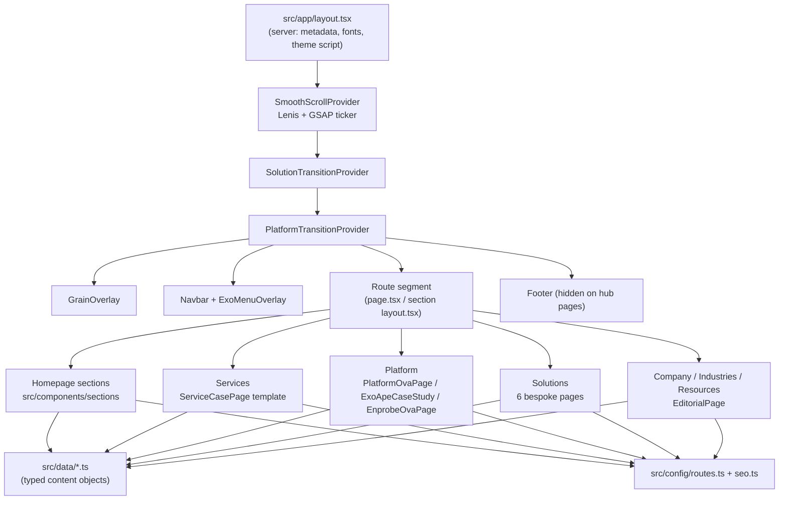

# Entersoft Security Website (`entersoft-web`)

The marketing and information website for **Entersoft Security**, an application-first cybersecurity services company, and for **EnProbe**, its exposure-assurance platform. It is built with **Next.js 16 (App Router)**, **React 19**, **TypeScript**, **Tailwind CSS 4**, **GSAP + ScrollTrigger**, **Lenis**, **Framer Motion** and **Three.js**.

This README is the entry point. The detailed technical record lives in [`docs/`](docs/) (see the [documentation index](#documentation-index)).

> Status snapshot (31 Oct 2026): 74 commits on `main` (18 Jun – 29 Oct 2026), 433 source files under `src/` (~61.7k lines of TS/TSX, ~12k lines of CSS), 56 route pages, `tsc --noEmit` passes, ESLint reports 3 errors and 11 warnings, and the production build uses Webpack (`next build --webpack`). Contact forms are UI only and do not send data. Full details are in [`docs/KNOWN_ISSUES_AND_FUTURE_WORK.md`](docs/KNOWN_ISSUES_AND_FUTURE_WORK.md).

---

## 1. What this website is

| | |
|---|---|
| **Business purpose** | Present Entersoft's enterprise security practices, the EnProbe platform and outcome-based security programmes, and convert visitors into briefings and contact requests. |
| **Audience** | CISOs, security and engineering leaders, compliance owners and procurement teams at regulated enterprises (fintech, SaaS, e-commerce, health, industrial IoT, Web3). |
| **Positioning** | "Application-first cyber assurance for modern enterprises" (homepage H1, `src/components/sections/Hero.tsx`). |
| **Brand model** | **Entersoft** is the services organisation. **EnProbe** is the technology and evidence platform. **Services** are expert-delivered practices. **Solutions** are enterprise programmes framed around business outcomes. The footer states this in one line: *"EnProbe finds the exposure. Entersoft experts validate it and stay with the fix."* (`src/components/layout/Footer.tsx`). |

Positioning rules come from [`Entersoft_Website_SEO_Content_Master_2026.md`](Entersoft_Website_SEO_Content_Master_2026.md), the approved SEO and copy master. [`docs/PAGES_AND_FEATURES.md`](docs/PAGES_AND_FEATURES.md) summarises it.

## 2. Technology stack summary

| Layer | Technology (installed version) | Status |
|---|---|---|
| Framework | Next.js 16.2.9 (App Router, Webpack for dev and build) | Implemented |
| UI | React 19.2.4, TypeScript 5.9 (strict) | Implemented |
| Styling | Tailwind CSS 4.3 via `@tailwindcss/postcss`, CSS custom properties, page-scoped CSS files | Implemented |
| Scroll and animation | GSAP 3.15 + ScrollTrigger, Lenis 1.3.23, Framer Motion 12.40 | Implemented |
| 3D | Three.js 0.185 | Implemented on the homepage only (track-record cylinder). Other scenes are on legacy pages. |
| Canvas 2D | Native canvas (footer wordmark, cylinder card textures) | Implemented |
| anime.js 4.5, d3-force 3 | | Legacy code only (redirected or unused components) |
| `@splinetool/react-spline` 4.1 | | Installed, **never imported** |
| Icons and utilities | lucide-react, clsx + tailwind-merge (`cn()`) | Implemented |
| Backend, API, database, auth | — | **None.** There are no API routes, server actions or auth. |

Full inventory with file references: [`docs/TECH_STACK.md`](docs/TECH_STACK.md).

## 3. Architecture overview



- **Pages are mostly thin server components.** Each exports `metadata` and renders one large client component that owns animation.
- **Content is data-driven.** Typed objects in `src/data/` feed shared templates (`ServiceCasePage`, `PlatformOvaPage`, `ExoApeCaseStudy`, `EditorialPage`).
- **There is one global scroll engine.** Lenis is driven by `gsap.ticker` and syncs ScrollTrigger on every scroll.
- **Theme** is `data-theme="light|dark"` on `<html>`. It is set before hydration from `localStorage.theme` (default `light`).

Deep dive: [`docs/PROJECT_ARCHITECTURE.md`](docs/PROJECT_ARCHITECTURE.md).

## 4. Main features

- **Cinematic homepage**, eight sections:
  - pinned hero video with a scroll crossfade;
  - Three.js glass-card cylinder ("Defense Measured in Certainty");
  - hover-driven services showcase;
  - horizontal-scroll outcome cards plus the "Our practice" FIND / VALIDATE / REMEDIATE / VERIFY panel;
  - stripe-wipe testimonials;
  - "Work in Motion" card wheel that unfolds to a grid;
  - stacked "Desk Briefs";
  - accreditation grid.
  - An animated **landing gradient** (`LandingGradient`) runs behind every section after the hero, in both themes.
- **Services**: a 3D card reel hub (`/services`) and seven service pages built from one data-driven template.
- **Platform (EnProbe)**: a 3D cube hub (`/platform`), the EnProbe overview, and 15 module pages on three templates.
- **Solutions**: a spiral gallery hub and six bespoke outcome pages, connected by an image-expand page transition.
- **Company, Industries and Resources**: 20 editorial pages generated from data.
- **Page transitions**: column-wipe and image-expand transitions for platform, services and solutions links.
- **SEO foundations**: per-page metadata and canonicals, JSON-LD, `sitemap.xml`, `robots.txt`, 308 redirects for legacy URLs, and automatic `noindex` on non-production hosts.
- **Accessibility and motion**: `prefers-reduced-motion` support in JS (`useReducedMotion`) and CSS (26 media queries). Lenis smooths mouse and trackpad scrolling at every window size; touch devices keep native scrolling, and their homepage pins use CSS `sticky` so they stay in step with the finger.

Animation details: [`docs/ANIMATIONS_AND_INTERACTIONS.md`](docs/ANIMATIONS_AND_INTERACTIONS.md). Design system: [`docs/UI_UX_DESIGN_SYSTEM.md`](docs/UI_UX_DESIGN_SYSTEM.md).

## 5. Route overview

| Area | Routes | Rendering |
|---|---|---|
| Home | `/` | `src/app/page.tsx` → 8 section components |
| Services | `/services` + 7 service pages + 5 cloud sub-pages | `ServicesReel`, `ServiceCasePage`, `CloudOfferingLayout` |
| Platform | `/platform`, `/platform/enprobe` + 15 modules (+ 8 alias redirects) | `PlatformHubScene`, `EnprobeOvaPage`, `PlatformOvaPage`, `ExoApeCaseStudy`, `PlatformSubpageTemplate` |
| Solutions | `/solutions` + 6 slugs | `SolutionsWorksGallery`, bespoke pages |
| Company | `/company/accreditations` + 8 slugs (`/company` redirects) | `EditorialPage` |
| Industries | 6 slugs | `EditorialPage` |
| Resources | 6 slugs | `EditorialPage` |
| Conversion | `/contact`, `/booking` (placeholder, `noindex`) | `FinalCTA` |
| SEO | `/sitemap.xml`, `/robots.txt` | `sitemap.ts`, `robots.ts` |

The full per-route table (component, layout, metadata, status) is in [`docs/PAGES_AND_FEATURES.md`](docs/PAGES_AND_FEATURES.md).

## 6. Installation and setup

Requirements:
- **Node.js ≥ 20.9** (required by Next 16). The project was developed on Node 24.22 with npm 11.19, installed through nvm-windows.
- Git.

```powershell
git clone https://github.com/Yash-Bagul01/Entersoft.git
cd Entersoft
npm install
Copy-Item .env.example .env.local   # then edit NEXT_PUBLIC_APP_URL if needed
```

| Variable | Required | Purpose |
|---|---|---|
| `NEXT_PUBLIC_APP_URL` | No | Base URL used only for `metadataBase` and the production-host check. Any host other than `entersoftsecurity.com` / `www.entersoftsecurity.com` is served `noindex`. Canonical URLs always use `PRODUCTION_URL` from `src/config/routes.ts`. |
| `NEXT_PUBLIC_API_URL` | — | Commented out in `.env.example` and reserved for a future form endpoint. Not read anywhere. |

## 7. Development commands

| Command | What it runs | Notes |
|---|---|---|
| `npm run dev` | `next dev --webpack` | Serves on http://localhost:3000. Editing `src/app/globals.css` (about 3,600 lines) can trigger a long recompile. |
| `npm run build` | `next build --webpack` | Webpack is required. Turbopack timed out on `globals.css` (see [`docs/TESTING_AND_DEBUGGING.md`](docs/TESTING_AND_DEBUGGING.md)). |
| `npm run start` | `next start` | Serves the production build. |
| `npm run lint` | `eslint` | Flat config in `eslint.config.mjs`, with 11 rules disabled. |
| `npx tsc --noEmit` | Type check | Passes as of 31 Oct 2026. |

Windows PowerShell 5 has no `&&`. Chain commands with `;`, or run them separately.

## 8. Project structure (top level)

```text
entersoft-web/
├── src/
│   ├── app/            # App Router: root layout, globals.css, routes, sitemap/robots
│   ├── components/
│   │   ├── layout/     # Navbar, ExoMenuOverlay, Footer, SmoothScrollProvider, transitions, modal
│   │   ├── sections/   # Homepage sections (Hero, TrackRecord3DCylinder, ...)
│   │   ├── services/   # ServiceCasePage, ServicesReel, cloud-resilience, + legacy bespoke pages
│   │   ├── platform/   # Hub, OVA, ExoApe, EnProbe templates + module data + legacy families
│   │   ├── solutions/  # Gallery, transitions, 6 bespoke solution pages
│   │   ├── site/       # EditorialPage (company/industries/resources)
│   │   └── ui/         # Button, MagneticButton, LandingGradient, ThemeToggle, ...
│   ├── config/         # routes.ts (URLs, canonical helpers), seo.ts (JSON-LD nodes)
│   ├── data/           # Typed content for every page family
│   ├── hooks/          # useReducedMotion, useStripeWipe, useMagnetic, ...
│   ├── lib/            # cn(), animation tokens, ScrollTrigger helpers
│   └── styles/         # tokens.css (design tokens, light/dark)
├── public/images, public/videos   # 311 images, 22 MP4s
├── docs/               # This documentation set
├── Entersoft_Website_SEO_Content_Master_2026.md   # Approved SEO & copy master
├── next.config.ts      # redirects, image config, allowedDevOrigins
└── AGENTS.md           # Rule for AI agents: read node_modules/next/dist/docs first
```

## Documentation index

| Document | Contents |
|---|---|
| [PROJECT_ARCHITECTURE.md](docs/PROJECT_ARCHITECTURE.md) | Application architecture, folder-by-folder guide, provider tree, data flow, templates |
| [TECH_STACK.md](docs/TECH_STACK.md) | Every technology: what, why, where, how, status |
| [PAGES_AND_FEATURES.md](docs/PAGES_AND_FEATURES.md) | Route inventory, navigation, redirects, page-by-page features, business positioning |
| [UI_UX_DESIGN_SYSTEM.md](docs/UI_UX_DESIGN_SYSTEM.md) | Tokens, colours, typography, theming, components, UX principles, accessibility |
| [ANIMATIONS_AND_INTERACTIONS.md](docs/ANIMATIONS_AND_INTERACTIONS.md) | GSAP, ScrollTrigger, Lenis, Framer Motion, Three.js, canvas, CSS motion, transitions |
| [ALGORITHMS_AND_PROGRAMMING_CONCEPTS.md](docs/ALGORITHMS_AND_PROGRAMMING_CONCEPTS.md) | Real algorithms (lerp, smoothstep, scroll progress, pin maths, Gaussian ripple...) with pseudocode |
| [CYBERSECURITY_DOMAIN.md](docs/CYBERSECURITY_DOMAIN.md) | Security concepts and frameworks represented on the site, and how they are framed |
| [AI_ASSISTED_DEVELOPMENT.md](docs/AI_ASSISTED_DEVELOPMENT.md) | How Antigravity and Cursor were used, prompt patterns, verification, human oversight |
| [DEVELOPMENT_HISTORY.md](docs/DEVELOPMENT_HISTORY.md) | Phases, commit history, CEO change batches, key decisions |
| [RESPONSIVE_DESIGN.md](docs/RESPONSIVE_DESIGN.md) | Breakpoints, per-section responsive behaviour, testing method |
| [PERFORMANCE_AND_OPTIMIZATION.md](docs/PERFORMANCE_AND_OPTIMIZATION.md) | Rendering, assets, animation and WebGL performance |
| [SEO_SECURITY_AND_DEPLOYMENT.md](docs/SEO_SECURITY_AND_DEPLOYMENT.md) | Metadata, canonicals, sitemap, JSON-LD, security posture, deployment readiness |
| [TESTING_AND_DEBUGGING.md](docs/TESTING_AND_DEBUGGING.md) | Checks, debugging history, verification workflow, setup and troubleshooting |
| [KNOWN_ISSUES_AND_FUTURE_WORK.md](docs/KNOWN_ISSUES_AND_FUTURE_WORK.md) | Technical debt, legacy code, broken links, claims needing approval, priorities |
| [CODE_EXAMPLES.md](docs/CODE_EXAMPLES.md) | Annotated real excerpts: page, template, hook, GSAP, Framer, Lenis, Three.js, responsive, form |
| [LEARNING_SYLLABUS.md](docs/LEARNING_SYLLABUS.md) | 18-module curriculum tied to real files in this repo |

## 9. Current implementation status

| Area | Status |
|---|---|
| Homepage (8 sections, both themes, landing gradient) | Implemented. The landing-gradient work is **uncommitted** as of 31 Oct 2026. |
| Services (hub, 7 template pages, 5 cloud sub-pages) | Implemented. The cloud sub-pages are linked through 404 URLs (known issue). |
| Platform (hub, EnProbe, 15 modules) | Implemented. Many pages lack canonicals. |
| Solutions (hub, 6 pages) | Implemented |
| Company, Industries, Resources | Implemented (editorial template) |
| Contact, Discuss-project modal | **Partially implemented**: the UI is complete, but submission is simulated and no data is sent |
| Booking | **Placeholder** page (`noindex`) |
| Backend, CMS, analytics, security headers | **Not implemented** |
| Seven legacy bespoke service pages and many component families | **Legacy**: their URLs are redirected or nothing imports them |

Evidence notation used throughout `docs/`: **Implemented**, **Partially implemented**, **Configured**, **Planned**, **Legacy**, **Unverified**.
