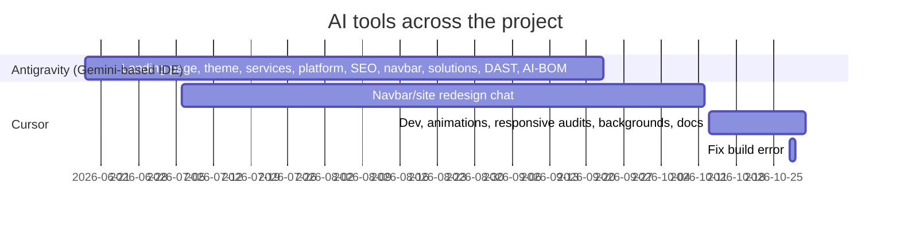
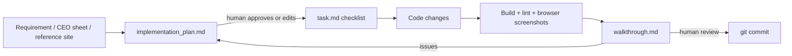
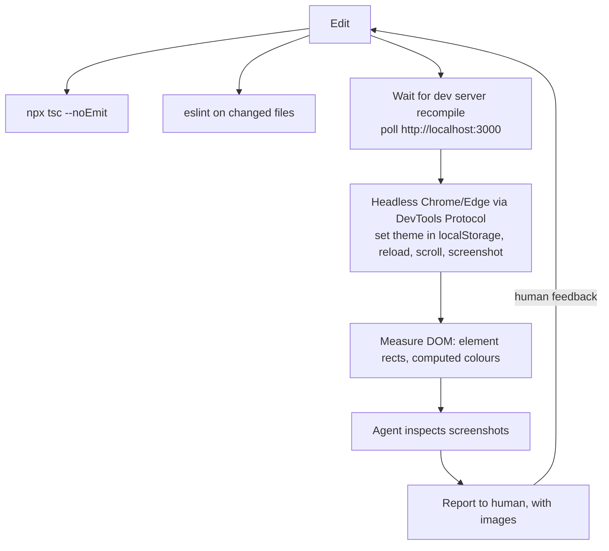

# AI-Assisted Development Workflow

How the website was built with AI coding agents (**Google Antigravity** and **Cursor**) under human direction, and what the record shows about prompting, planning, verification and oversight.

Related: [DEVELOPMENT_HISTORY.md](DEVELOPMENT_HISTORY.md) · [TESTING_AND_DEBUGGING.md](TESTING_AND_DEBUGGING.md)

---

## 1. Evidence base

| Source | What it contains | How it was inspected |
|---|---|---|
| Antigravity workspace `~/.gemini/antigravity-ide/brain/` | 146 conversation folders. **57** mention Entersoft (18 Jun – 23 Sep 2026). They contain 51 `implementation_plan.md`, 27 `task.md` and 55 `walkthrough.md` artifacts, QA and regression audits, and about 10,000 PNG and 600 WebP screenshots. | Folder listing, plan titles and plan section headings. Conversation contents were not read in full. |
| Cursor agent transcripts | 3 top-level chats ("Navbar popups and site redesign", 6 Jul – 12 Oct; "Dev run command and animations", 13 – 31 Oct; "Fix build error", 28 Oct) plus subagent runs | Titles, first prompts, timestamps, selected passages |
| Git history | 74 commits, 18 Jun – 29 Oct 2026 | `git log --stat` |
| Repository artifacts | `AGENTS.md`; screenshot and verification folders (`.tmp-*`); helper scripts (`.tmp-classify-unused.mjs`, `.tmp-nav-shots/align.mjs`, `_dl-hub-cards.mjs`, `_extract_shapes.py`) | Direct reading |

**What the evidence cannot show:**
- Which tool wrote any particular line of code.
- Whether every plan was carried out as written.

The tool attributions below are **inferred from matching dates**. Antigravity plans on a given day line up with commits on the same day.

## 2. Timeline of tool usage



- **Antigravity** was the main build agent from the first commit (18 Jun) until late September. Its first plan was "Implementation Plan - Entersoft Security Landing Page" (18 Jun), dated the same day as the `Entersoft Landing page foundation` commit.
- **Cursor** was used from July for targeted redesigns. From mid-October it became the main tool for:
  - responsive audit batches;
  - dark/light background work;
  - the Webpack build fix;
  - this documentation.
- `AGENTS.md` is an instruction file for coding agents. It says Next 16 has breaking changes and that agents must read `node_modules/next/dist/docs/` before writing code. A `CLAUDE.md` existed at scaffold time and was deleted on 14 Jul.

## 3. The plan → implement → walkthrough loop (Antigravity)

Antigravity produced a consistent artifact set for each task. The plan headings follow a fixed template:

```text
# Implementation Plan — <task>
## User Review Required        ← constraints, approvals needed, design-lock notices
## Open Questions              ← ambiguities the agent will not resolve on its own
## Proposed Changes            ← grouped by component; each file marked [NEW]/[MODIFY]
### Component …
## Verification Plan
### Automated (build / lint)
### Manual (viewport / browser verification)
```

That template was followed by `task.md` (a checklist) and `walkthrough.md` (what changed, with screenshots).



**Real example: the human approval gate.** In "CEO-Directed Website Changes (Batch 1)" (20 Jul 2026), the agent noticed a conflict in the instructions and asked before acting:

> *"The prompt specifies that `Navbar.tsx` is **not** in the permitted list of files to modify, yet Section 5.1 explicitly instructs us to update the mega-dropdown link labels… **Please approve if we should modify `Navbar.tsx`**."*

The plan marked the Navbar change as **(Pending Approval)**.

### Plan titles (Entersoft, chronological)
Selected from the 51 plans. These show the breadth of AI-assisted work:

| Date | Plan |
|---|---|
| 18 Jun | Implementation Plan – Entersoft Security Landing Page |
| 19 Jun | Light Theme Integration |
| 20–22 Jun | Hero Video & Track Record Card Animations; Operational Comparison Section; Regulatory Credentials Animations; Globe Section Replacement |
| 29 Jun – 2 Jul | Services Sub-Pages; AppSec Platform Page ("Gotham Style"); AppSec Animations, Resend-Style 3D Cube |
| 8–15 Jul | Colorful Scroll-Triggered Framework Cards; VAPT 3D Card Stack; Pure Black & White Managed Cloud Security Rebuild; Compliance Management Subpage; Smart Contract Visuals & SEO Overhaul |
| 20 Jul | **CEO-Directed Website Changes (Batch 1)** |
| 21 Jul | **Full Responsive Audit & Surgical Fix** |
| 29 Jul – 4 Aug | Bespoke UI for 8 Platform Subpages; Cyber Ontology redesign; Align Platform Subpages with Invicti navigation; SCA Page Redesign |
| 3–11 Aug | Skiper16 Card Stack in Track Record; **3D Cylinder Scroll Animation for Validated Track Record (aikawakenichi.com reference)**; Secrets (builderstable / Thayon); IaC Subpage |
| 21 Aug | Delivery Model, Credentials & Conversion Strategy Update |
| 24–25 Aug | Exo Ape Styled Menu & Full-Screen Menu; **Performance Optimization & Smooth User Interactions** |
| 29 Aug – 1 Sep | Produx-Style Solutions Transition; DAST Subpage (Exoape Fluid Glass) |
| 4–6 Sep | **CEO Changes Batch 4: AI Systems Assurance**; **CEO Changes Batch 4: Penetration Testing (VAPT)** |
| 7–8 Sep | Trionn-Style Section Transitions; Shader.se aesthetics; Customer Outcomes Horizontal Scroll |
| 16–23 Sep | Belenjones-Inspired 3D Cuboid Platform Hub; Redesign AI-BOM (Family.co) |

## 4. Prompt-engineering patterns used

These patterns come from the recorded prompts (Cursor first prompts and plan preambles) and from the structure of the plans.

| Pattern | What it looks like in this project |
|---|---|
| **Reference-driven design prompts** | "Match the hero to `<Webflow/Awwwards site>`", "use this gradient: grainient.supply/backgrounds/galactic-23", "replicate Produx Studio 'Brand Chemistry' scroll animation". The agent studies the reference (screenshots, or frames pulled from recordings with `_extract_shapes.py`) and maps it onto the existing components. |
| **Design-lock / UI-preservation instructions** | CEO batch plans open with *"CRITICAL RULE — NO DESIGN CHANGES… Preserve existing page layout, section order, typography, font sizes, spacing, colors, gradients, borders, cards, animations, WebGL/Three.js, GSAP, Framer Motion, Lenis…"*. Recent Cursor prompts say "don't change anything else from the design perspective". |
| **Permitted-file lists** | CEO Batch 1 listed which files could be modified. That list is what triggered the Navbar approval question. |
| **Audit-only prompts** | "Responsive Audit Batch 2: Platform Pages", "Batch 4: Company Pages + Solutions QA", "technical SEO audit of the Next.js app (report only)". These produce findings first, then a separate fix pass. |
| **Requirement decomposition (batches)** | CEO feedback was split into numbered batches per page family, so each could be reviewed separately. |
| **Claim-correction prompts** | Replace unsupported metrics with evidence-safe wording, for example "0 False Positives" became "Human-Validated", and "600+ AI systems" became "Scope-Defined". |
| **Role-based master prompts** | Long structured prompts that set roles (e.g. "Act as a Principal Software Architect…"), phases, accuracy rules and output files. This document set was produced from one. |
| **Verification instructions** | "Verify UI changes in the browser before declaring complete", "run tsc", "check both themes", "check 1440/1024/768/390 widths". |
| **Operational guardrails** | Standing constraints in the Cursor sessions: don't reset or stash uncommitted work; don't kill a healthy dev server or start a second one on port 3000; don't run `next build` against the dev `.next`; don't commit or deploy unless asked; don't send real leads. |
| **Iterative refinement** | Short follow-ups after reviewing screenshots: "add motion so it feels like it's moving", "make the sections look continuous", "make the transition from blue to black smooth". |
| **Multiple-choice clarification** | When a request was ambiguous, the agent offered options. Example: where the landing gradient should go was answered as "behind sections below the hero; Obscura; pale for light theme". |

## 5. AI-assisted analysis and implementation

| Activity | Evidence |
|---|---|
| Repository inspection and architecture analysis | Plans list every `[MODIFY]` file with paths. Cursor subagents ran parallel explorations (routes, animation systems, design system, git history) for this documentation. |
| Dependency and dead-code analysis | `.tmp-classify-unused.mjs` uses the TypeScript compiler API (`noUnusedLocals`) to group unused declarations. `.tmp-nav-shots/unused-summary.mjs` counts them. |
| Component creation | Each design iteration added a component family. This is why `NovaSecrets_*`, `Secrets_*` and `ThayonSecrets_*` (three secrets designs) and `ai-systems`, `-v2`, `-v3` all exist (see [KNOWN_ISSUES](KNOWN_ISSUES_AND_FUTURE_WORK.md)). |
| Animation implementation | Plans name the techniques: GSAP `quickTo`, `ScrollTrigger.batch`, text-scramble hooks, the 3D cylinder, Exo Ape menus, Trionn transitions. |
| Responsive work | "Full Responsive Audit & Surgical Fix" (Jul): breakpoint tokens, critical render fixes, layout, sections, touch and performance. Later "Responsive Audit Batch" prompts in Cursor (Oct). |
| Performance work | "Performance Optimization & Smooth User Interactions" (Aug): hero video, Lenis lag smoothing, raster filters, WebGL cylinder, global styling. `lagSmoothing(500, 33)` is in the code today. |
| SEO and content | A subagent extracted a "machine-checkable SEO spec" from the SEO master (21 Aug). The `SEO + UI changes 1` commit introduced the redirects, sitemap, robots and canonical config. |
| Debugging | The "Fix build error" chat: diagnosis of a Turbopack timeout on `globals.css`, then the switch to `next build --webpack` (commit `dc482ac`). |
| Asset sourcing | `_dl-hub-cards.mjs` downloaded licensed-source (Pexels) photos. In the gradient work, reference previews were fetched only to a temp folder for colour inspection, and no unlicensed assets were added to the repo. |

## 6. AI-assisted verification



**Practices recorded in the Cursor sessions:**
1. **Headless-browser screenshots at set viewports.** Temporary `_*.mjs` scripts drove Chrome or Edge through the DevTools Protocol on ports 9333–9340. Browser profiles were kept in the OS temp folder, and the scripts were deleted after use. `.tmp-nav-shots/align.mjs` is a surviving example: it measures the platform hero's rotating words at 1440×900.
2. **Pin settling.** Before measuring, the scripts set `localStorage.theme`, reloaded, waited about 9 s, and scrolled to the bottom and back so the ScrollTrigger pins settled.
3. **Recompile awareness.** Editing `globals.css` triggered 10–15 minute webpack recompiles on this machine. Scripts polled the server until it responded, rather than killing it.
4. **Type and lint checks.**
   - Before reporting an error, agents checked whether it already existed at `HEAD`. For example, the `react-hooks/immutability` error in `TrackRecord3DCylinder.tsx` was confirmed to predate the gradient work.
   - Screenshot folders (`.tmp-hero-check`, `.tmp-flow-*`, `.tmp-visu2`, `.tmp-belen2`) hold the visual evidence for earlier phases.

## 7. Human oversight

What the record shows the human developer did:

- **Set direction and taste.** Every visual change starts from a human choice of reference: a site, a gradient, or "make it feel like it's moving".
- **Relayed and enforced business requirements.** CEO audit sheets were turned into batched prompts with design locks and claim rules.
- **Approved scope.** Plans held "User Review Required" and "Open Questions" sections, and changes outside the permitted files waited for approval.
- **Reviewed visually and iterated.** Many of the final prompts are corrections made after review: continuity between sections, dark-theme contrast, a smoother handoff into the footer.
- **Owned version control.** Commits were made by the developer at milestones. Agents were told not to commit or push unless asked.

**Lessons the history supports:**
- **Generated design variants pile up.** Several near-duplicate component families remain because new variants were added rather than old ones removed.
- **Claims need source evidence.** Unsupported metrics reached the code and had to be removed in CEO batches. Some still remain; see [KNOWN_ISSUES §4](KNOWN_ISSUES_AND_FUTURE_WORK.md#4-business-content-requiring-approval).
- **Guardrails in prompts work.** Design-lock and file-permission rules produced narrow, reviewable diffs.
- **Verify agent claims.** For example, the subagent reports used for this documentation were spot-checked against source:
  - the `routes.ts` cloud-route bug;
  - the undefined font variables;
  - the `Button` ref behaviour.
