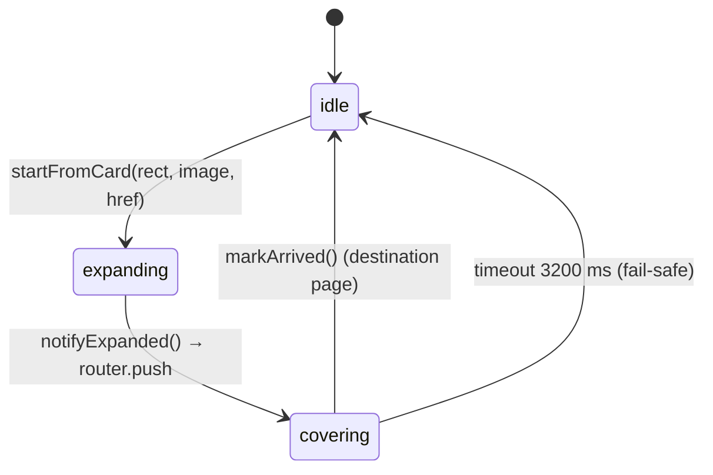

# Algorithms and Programming Concepts

This document covers the calculations and logic patterns that actually appear in the code. Each entry explains the concept, why the project needs it, where it is used, and how it works, with pseudocode.

**How to read the examples:**
- **Real** marks code taken from the repository.
- **Pseudocode** marks a simplified teaching version.
- **Legacy** marks code that exists only in unreachable components.

The project has **no** search, sorting, recommendation or data-structure-heavy algorithms. It is a static marketing site. Its interesting logic is in **interpolation, geometry, scroll maths and rendering control**, and that is what this document covers.

Related: [ANIMATIONS_AND_INTERACTIONS.md](ANIMATIONS_AND_INTERACTIONS.md)

---

## 1. Linear interpolation (lerp) and exponential smoothing

**Concept.** `lerp(a, b, t) = a + (b − a)·t` gives the point a fraction `t` of the way from `a` to `b`. If you call it every frame with a constant `t` (for example 0.1) and feed the result back in as `a`, the value closes a fixed fraction of the remaining gap each frame. That produces a smooth, decelerating "chase" called exponential smoothing.

**Why.** It makes a value follow a moving target (pointer, scroll-driven goal) smoothly, with no tween to manage.

**Where:**

| Use | File | Smoothing factor |
|---|---|---|
| Cursor follower | `HeroCursor.tsx` | `LERP = 0.1` |
| Cylinder rotation, tilt and scale toward ScrollTrigger targets | `TrackRecord3DCylinder.tsx` | 0.12–0.14 per frame |
| Underline amplitude | `FooterLineLink.tsx` | 0.16 |
| Shader mouse (legacy) | `Iac_IridescenceBackground.tsx` | 0.05 |
| Particle formation (legacy) | `ParticleCloud.tsx` | 0.075 |

```text
// Pseudocode
every frame:
  current += (target - current) * k      // k in (0,1); bigger = snappier
  render(current)
```

**What to understand.** The smoothing depends on frame rate: at 120 Hz it converges about twice as fast as at 60 Hz. A frame-rate-independent version is `k' = 1 − (1 − k)^(dt·60)`. This project uses the simple per-frame form.

## 2. Clamping and normalised scroll progress

**Concept.** Convert a pixel position into a 0–1 progress value, then clamp it so it can't go out of range.

**Where:**
- `Differentiators.tsx` (`drive()`)
- `useStripeWipe.ts`
- `InsightsBlog.tsx`
- `DesignInMotion.tsx`

All of them use `gsap.utils.clamp`.

```90:94:src/components/sections/Differentiators.tsx
      const raw = gsap.utils.clamp(0, 1, -pin.getBoundingClientRect().top / range);
      const travelPx = travel();
      const holdPx = hold();
      const moveUntil = travelPx / Math.max(1, travelPx + holdPx);
      const p = gsap.utils.clamp(0, 1, raw / moveUntil);
```

```text
// Pseudocode: progress of a tall "pin wrapper" through the viewport
range = wrapper.height - viewport.height        // scrollable distance while pinned
raw   = clamp(0, 1, -wrapper.top / range)       // 0 at start of pin, 1 at end
```

**Sub-ranges and phases.** Re-normalising `raw` into a smaller window splits one scroll into phases. For example, `p = raw / moveUntil` finishes the horizontal travel early and leaves a "hold" period. The same idea drives:
- the three TrackRecord phases (`p ≤ 0.16`, `0.16–0.45`, `> 0.45`);
- DesignInMotion's `rise = p/0.58` and `unfold = (p − 0.56)/0.3`. These two windows overlap slightly, so the phases blend into each other.

```text
phaseProgress(p, start, end) = clamp(0, 1, (p - start) / (end - start))
```

`Math.max(1, …)` guards every denominator against divide-by-zero while layout hasn't been measured yet.

## 3. Easing functions

**Concept.** An easing function maps linear progress `t ∈ [0,1]` to a curved progress value, which gives motion acceleration and deceleration.

| Easing | Formula | Where |
|---|---|---|
| Smoothstep | `t²(3 − 2t)` | Differentiators card rise (`t * t * (3 - 2 * t)`) |
| easeInOutCubic | `t<0.5 ? 4t³ : 1 − (−2t+2)³/2` | DesignInMotion phases |
| Exponential ease-out | `min(1, 1.001 − 2^(−10t))` | Lenis `easing` |
| `power2.out`, `power3.out`, `power4.inOut`, ... | GSAP's built-in polynomial eases | Timelines; `gsap.parseEase("power2.out")` is also called as a plain function inside TrackRecord's `onUpdate` |
| Cubic Bézier `[0.22, 1, 0.36, 1]` | CSS / Framer Motion | ServicesShowcase stack and captions, `PALANTIR_EASE` |
| `ease: "none"` | Linear | Stripe wipe, so the bars track the scroll exactly |

**What to understand.**
- Scrubbed (scroll-linked) animations often use linear easing, because the user's scroll already supplies the "feel".
- Eases are applied *inside* sub-phases instead.

## 4. Interpolating between two layouts (wheel → grid)

**Concept.** Compute two complete layouts for each card, a "from" pose and a "to" pose. Then blend every property between them with the phase progress.

**Where:** `DesignInMotion.tsx` (live) and `InsightsBlog.tsx` (card stack → row).

```text
// Pseudocode
for card i:
  θ    = startAngle + i * step
  from = { x: cx + R*sin θ, y: cy - R*cos θ, rotZ: θ, scale: s0, w: w0, h: h0, radius: r0 }
  to   = gridCell(i)                                   // column/row → x,y,w,h
  t    = easeInOutCubic(clamp01(unfold - i*0.04))       // per-card stagger
  set(card, mix(from, to, t))                           // mix = lerp each property
```

**Concepts involved:**
- polar → Cartesian conversion (`sin`/`cos`);
- per-property lerp;
- **stagger by offsetting progress** (`unfold − i·0.04`) rather than by time.

## 5. Vector clamping (magnetic pull)

**Concept.** Scale a 2D displacement vector, then cap its length at a maximum while keeping its direction.

**Where:** `src/hooks/useMagnetic.ts` (live).

```text
d     = pointer - elementCenter
if |d| < radius:
  pull = d * strength
  if |pull| > 10: pull = pull / |pull| * 10            // normalise, then scale to max
  tween(element, pull, 0.3s, power2.out)
else:
  tween(element, 0, 0.5s, power3.out)
```

`Math.hypot(x, y)` computes the vector length. Dividing the vector by its length normalises it to a unit vector, which is the same operation used in physics and game code.

## 6. Gaussian falloff ripple (canvas wordmark)

**Concept.** Displace points with a travelling sine wave whose strength decays with distance from the pointer, following a Gaussian `exp(−d²/σ)`.

**Where:** `src/components/layout/LinedWordmark.tsx` (live, footer).

```text
for each point (x, y) on each line run:
  d² = (x - mx)² + (y - my)²
  y' = y + sin(0.045x + 7t + 0.08y) * 16 * exp(-d² / 14000)
```

**How the parts work:**
- `0.045x` sets the spatial frequency.
- `7t` animates the wave over time.
- `0.08y` offsets each row's phase.
- 16 px is the peak amplitude.
- The Gaussian term makes the effect fade smoothly to zero, with no hard edge.

**Mask scanning (preprocessing).** The word is rasterised once to an offscreen canvas. The code then walks each 5-px row of pixel alpha values and records start/end x positions where alpha is above a threshold. This is effectively **run-length encoding**: the word becomes a list of horizontal segments that are cheap to redraw each frame.

## 7. Viewport anchoring for a continuous background

**Problem.** Seven separate sections each have their own animated gradient. Each gradient is positioned relative to its own section, so at a section boundary the patterns don't line up and you see a seam.

**Solution.** Shift each section's gradient layer by the negative of the section's distance from the top of the viewport. Every layer then paints as if it were fixed to the viewport, and they all line up. `position: fixed` can't be used here, for two reasons:
- GSAP pins and transforms on ancestor elements create new containing blocks, which breaks fixed positioning.
- `overflow-x: hidden` on `html` and `body` disables `sticky`.

```12:20:src/components/ui/LandingGradient.tsx
function sync() {
  frame = 0;
  const tops: number[] = [];
  tracked.forEach((el) => tops.push(el.getBoundingClientRect().top));
  let i = 0;
  tracked.forEach((el) => {
    el.style.setProperty("--lg-y", `${-tops[i++]}px`);
  });
}
```

```css
/* pseudocode of the CSS side */
.landing-gradient__flow { top: 0; height: 100lvh; transform: translate3d(0, var(--lg-y), 0); }
```

**Concepts involved:**
- **Coordinate transformation:** converting section-local coordinates to viewport coordinates.
- **Batched DOM reads before writes:** this avoids forced synchronous layout.
- **rAF coalescing:** many scroll events per frame collapse into one `sync()`.
- **Module-level singleton listeners:** one scroll listener shared by all instances, attached with a reference count via a `Set`.

## 8. Seamless looping of repeating gradients

**Concept.** A `repeating-linear-gradient` with period `P` at angle θ looks identical after being shifted by exactly `P` along its gradient direction. If you animate a translation of `(P·sin θ, P·cos θ)` over the loop duration, the last frame equals the first, so there is no visible jump.

**Where:** the `landing-gradient-flow-a/b` keyframes in `globals.css` and the `sc-prism` flow in `solution-case.css`.

At 150°, the direction vector is `(sin 30°, cos 30°) = (0.5, 0.866)`:

| Layer | Period | Translation per loop |
|---|---|---|
| Band | 1200 px | `(600px, 1039px)` |
| Streaks | 420 px | `(210px, 364px)` |

The layers sit at `inset: −1200px`, so the moving pattern never reveals an edge.

## 9. Scroll velocity as an input

**Where:** TrackRecord's `onUpdate`, `scale += self.getVelocity() * 0.000015`.

ScrollTrigger reports scroll speed in px/s. Adding a tiny velocity term makes the cylinder "breathe" bigger when the user scrolls fast. Because every frame eases back toward the base target (lerp), the bump decays on its own.

## 10. Discrete step snapping (wheel → one section)

**Where:** `PlatformOvaPage.tsx`, `EnprobeOvaPage.tsx` and `ServicesReel.tsx` (live).

```text
on wheel (passive: false):
  if animating: preventDefault(); return
  dir = sign(deltaY)
  index = clamp(index + dir, 0, last)
  preventDefault()
  lenis.scrollTo(sectionTop(index), { duration: 0.62 }); lock until complete
```

**Concepts involved:**
- **Event throttling by state lock:** the code ignores input while an animation is running. This is a mutex rather than a timer-based debounce.
- **Non-passive listeners:** `preventDefault()` requires `{ passive: false }`.

## 11. Rendering control: visibility gating and frame budgeting

| Technique | Where | What it does |
|---|---|---|
| `IntersectionObserver` pause | TrackRecord (threshold 0.02); legacy canvases | Stops rendering when the element is off-screen |
| Visibility-gated autoplay | Testimonials (≥35% visible) | Prevents timers from running off-screen |
| `useInView` (Framer) | Legacy canvases | Same idea, through a hook |
| Early return in the rAF loop | TrackRecord | Keeps the loop alive cheaply while hidden |
| Partial texture refresh | TrackRecord redraws the active card's canvas every third frame while hovered | Spreads canvas cost across frames |
| Frame-interval throttling | Legacy `NoiseField` (24 fps), `ThreatWaveform` (30 fps mobile / 60 desktop), `TokenStream` | `if (now - last < 1000/fps) return` |
| DPR capping | `Math.min(devicePixelRatio, 2)`; 1.5 or 1 on some legacy/mobile scenes | Bounds fill-rate cost on high-density screens |

## 12. Observers as event sources

- **`MutationObserver`** on `<html data-theme>` (`Navbar`, `TrackRecord3DCylinder`). It is a reactive bridge from a DOM attribute to component logic, so no global store is needed.
- **`ResizeObserver`:**
  - `LandingGradient` observes `document.body`, because content-height changes move sections without firing scroll events.
  - `LinedWordmark` observes its own box.
- **Timed `ScrollTrigger.refresh()` calls** (Differentiators at 160, 600, 1400 and 2600 ms, plus image `load` events). A pragmatic answer to late-loading layout.

## 13. State machines

`SolutionTransitionContext.tsx` (live) is a small explicit state machine:



**What to understand.** The timeout fallback is what makes the transition robust. Without it, a page that never calls `markArrived()` would leave a full-screen overlay covering the site.

## 14. Route resolution and slug normalisation

**Where:** `src/config/routes.ts`.

| Function | Job |
|---|---|
| `getServiceKeyFromSlug(slug)` | Maps any historical or current slug (`appsec`, `application-security-assurance`, `application-security-testing`) to one data key, so renamed URLs keep working with the same data |
| `getServiceRoute(key)` | The reverse mapping, from a data key to its canonical route |
| `getCanonicalUrl(route)` | Joins the route onto `PRODUCTION_URL` |
| `IS_PRODUCTION_HOST` | An immediately-invoked function that parses `METADATA_BASE` with `new URL()` inside `try/catch`, and checks the host against an allow-list |
| Type guards (`isSolutionLandingSlug`) | Narrow `string` to a literal union, so `SOLUTION_LANDING_BY_SLUG[slug]` is type-safe |

```text
// Pseudocode of [slug] route resolution
slug = await params.slug
if not isKnown(slug): notFound()        // plus dynamicParams=false at build time
data = BY_SLUG[slug]
return componentFor(slug)(data)          // explicit branch table, fallback template
```

## 15. Data transformation and composition

- **Copy assembly:** `serviceCaseCopy.ts` builds one uniform `ServiceCaseCopy` shape from five differently-shaped sources (`servicePagesData`, `cloudResilienceHubData`, `digitalTrustData`, `cyberDefense`, `aiZkpass`). This is the **adapter pattern**: the template knows only one shape.
- **Array operations:**
  - `.map` renders every list;
  - `.slice(0, 5)` and `.slice(0, 6)` pick the testimonials and Design-in-Motion cards;
  - `tagsFrom` caps tags at 8;
  - `.filter` toggles the selected service pills in `FinalCTA`;
  - `.slice().reverse()` orders the stripe bars.
- **Lookup tables:** `Record<Slug, Data>` maps (`SERVICE_CASES`, `SOLUTION_LANDING_BY_SLUG`) replace `switch` statements.

## 16. Conditional rendering and capability detection

| Check | API | Used for |
|---|---|---|
| Fine pointer vs touch | `matchMedia("(hover: hover) and (pointer: fine)")`, `(pointer: coarse)` | Hover vs tap behaviour; turning off the cursor and magnetic effects |
| Compact viewport | `matchMedia("(max-width: 1023px)")` | Camera settings, Lenis duration, layout branches |
| Wide viewport | `matchMedia("(min-width: 768px)")` | InsightsBlog desktop stack vs mobile list |
| Motion preference | `useReducedMotion()` | Static alternatives |
| Environment | `process.env.NODE_ENV === "production"` | Prefetching every service route only in production builds |

## 17. Form validation (client-side only)

**Where:** `FinalCTA.tsx` and `DiscussProjectModal.tsx`.

1. **HTML constraints:** `required`, `type="email"`, `minLength={20}`.
2. **JS guard:** a presence check (`if (!email || !name) return`) plus a details-length check in the modal.
3. **Double-submit lock:** the `isSubmitting` flag.
4. **Simulated latency:** `setTimeout`, then the success state.

There is **no** input sanitisation and no server-side validation, because nothing is sent anywhere. Both must be added together with any real submission endpoint; see [SEO_SECURITY_AND_DEPLOYMENT.md](SEO_SECURITY_AND_DEPLOYMENT.md).

## 18. Focus trapping (accessibility logic)

**Where:** `DiscussProjectModal.tsx`.

```text
on open: remember document.activeElement; focus Close button
on keydown Tab:
  focusables = dialog.querySelectorAll(interactive selectors)
  if shift && active == first: focus(last); preventDefault
  if !shift && active == last: focus(first); preventDefault
on Escape: close
on close: restore focus to remembered element
```

## 19. Loading, lazy loading and code splitting

- **`next/image`:**
  - images lazy-load by default;
  - `priority` is set on the first two showcase images;
  - `sizes` gives the browser a responsive hint;
  - `quality` is chosen from the allowed set `[75, 85, 95]`.
- **Code splitting:** automatic per route. The only explicit `next/dynamic` calls (with `ssr:false`) are in legacy pages.
- **Router prefetch:** `ServicesReel` and `PlatformPageTransition` call `router.prefetch` on the routes users are likely to visit next.
- **Loading states:** there are no `loading.tsx` or `Suspense` boundaries. "Loading" exists only as local UI states (form submitting, video retry).

## 20. Legacy algorithms (for study)

| Algorithm | File | Idea |
|---|---|---|
| Force-directed graph layout | `cloud-v2/canvas/ForceGraph.tsx` | d3-force: many-body repulsion (−22), spring links (distance 38), centring. Alpha decay cools the simulation. |
| Particle system with phases | `cloud-v2/canvas/ParticleCloud.tsx` | Velocity integration with edge bounce → lerp to targets → random wander, with a 0.012% per-frame cluster switch |
| Procedural terrain | `secrets/NovaSecrets_Hero.tsx` | Sums of Gaussian bumps make a ridge height field |
| GLSL flow field | `iac/Iac_IridescenceBackground.tsx` | Iterated domain warping with `cos`/`sin`, `smoothstep` masks |
| Proximity graph | `AppSecPlatformPage.tsx` | Connect particle pairs closer than 130 px; O(n²) for 45 nodes |

**Noise.** Perlin or simplex noise is **not** used anywhere. All randomness comes from `Math.random()`, and the film grain is SVG `feTurbulence`.
