# Cybersecurity Domain and Content Engineering

This document lists the security concepts the website represents and explains each one. For every topic it records where the site presents it, how it is positioned, and which standards it cites. The goal is that developers and content editors understand the subject matter they are editing.

**Accuracy rules for this document:**
- If a framework is mentioned on the site, the site *refers* to it. That is not the same as Entersoft holding a certification.
- The site claims three held credentials: **CREST** accreditation, **CERT-In** empanelment, and an **ISO/IEC 27001** ISMS. They appear on `/company/accreditations` and in `src/data/certifications.ts`. The repository cannot verify them; verification needs certificate records.
- Positioning quotes come from the live data files named in each row.

Related: [PAGES_AND_FEATURES.md](PAGES_AND_FEATURES.md) · [KNOWN_ISSUES_AND_FUTURE_WORK.md §4](KNOWN_ISSUES_AND_FUTURE_WORK.md#4-business-content-requiring-approval)

---

## 1. How the content model maps to security delivery

```mermaid
flowchart LR
  subgraph EnProbe["EnProbe platform (/platform)"]
    SC[Scan code: SAST · SCA · SBOM · Secrets · IaC · Container]
    RT[Runtime & exposure: DAST · API · ASM · Agentic pentest · Cloud AppSec · AI AppSec]
    DEC[Decisioning: ASPM · Threat intel · Compliance reporting]
  end
  subgraph Services["Expert practices (/services)"]
    AS[Application security testing]
    PT[Penetration testing / adversarial validation]
    CL[Cloud & identity security]
    GRC[GRC, privacy & audit readiness]
    MDR[MDR / SIEM / detection engineering]
    W3[Smart contract & Web3]
    AI[AI & agentic-system security]
  end
  subgraph Solutions["Programmes (/solutions)"]
    S1[API discovery] & S2[AI-BOM] & S3[Manage vulnerabilities] & S4[Automate workflows] & S5[Track AppSec KPIs] & S6[Open-source risk]
  end
  EnProbe -->|evidence, prioritisation| Services
  Services -->|human validation, remediation, retest| EnProbe
  EnProbe & Services --> Solutions
```

The lifecycle language that runs through the site is *Discover → Contextualise → Validate → Remediate → Prove*. On the homepage it is shortened to FIND / VALIDATE / REMEDIATE / VERIFY.

## 2. Topic reference

Each entry gives three things:
- **Concept:** what the topic means.
- **Why it matters:** the risk it addresses.
- **On the site:** routes and data files, with the positioning in the site's own words.

### Application security (AppSec)
- **Concept:** securing software across design, code, dependencies, build and runtime.
- **Why it matters:** applications hold business logic, data and identities, so they are the main attack surface.
- **On the site:**
  - `/services/application-security-testing` (`services.ts`): *"Embed expert-led testing, secure engineering and continuous assurance across applications, APIs, code and release workflows."*
  - The homepage positioning is "application-first".

### SAST (static application security testing)
- **Concept:** analysing source code without running it to find vulnerable patterns. A typical example is a taint flow from an untrusted *source* to a dangerous *sink*.
- **Why it matters:** it catches flaws before deployment, and it is cheap to run in CI.
- **On the site:** `/platform/sast` (`SAST_OVA` in `platformOva.ts`): *"A finding is only real if the path from source to sink exists."* The site frames this as reachability-aware results rather than raw pattern hits.

### DAST (dynamic application security testing)
- **Concept:** testing a running application from the outside, the way an attacker would.
- **Why it matters:** it finds runtime and configuration flaws that static analysis can't see.
- **On the site:** `/platform/dast` (`dastCase.ts`): *"tests live web applications… the way an attacker would — then proves what it finds."*

### SCA (software composition analysis)
- **Concept:** inventorying open-source dependencies, including transitive ones, and matching them against vulnerability and licence databases.
- **Why it matters:** most application code is inherited. The site puts it this way: *"The risk is rarely the package you chose."*
- **On the site:** `/platform/sca` and `/solutions/manage-open-source-risk`.
- **Data sources referenced:** NVD, OSV, CISA KEV and EPSS (`platformOva.ts`, `platform.ts`).

### SBOM (software bill of materials) and licence risk
- **Concept:** a machine-readable list of the components in a build.
- **Why it matters:** SBOMs are required by procurement and regulators, and they speed up incident response (for example, answering "are we affected by CVE-X?").
- **On the site:** `/platform/sbom-license-risk`: *"The bill of materials is taken from the build, not reconstructed later."*
- **Formats:** CycloneDX and SPDX (`platformOva.ts`, `solutionLandings.ts`).

### Software supply-chain security
- **Concept:** protecting everything that goes into and produces software: dependencies, build systems and artefacts.
- **On the site:** referenced in `platform.ts` and `solutionLandings.ts` (*"licensing risks across your software supply chain"*).
- **Not mentioned:** SLSA.

### API security
- **Concept:** discovering and testing APIs, including shadow, zombie and rogue endpoints, for authorization and logic flaws.
- **On the site:**
  - `/platform/api-security` (`apiCase.ts`): *"discovers shadow, zombie and rogue APIs… proves OWASP API Top 10 findings."*
  - `/solutions/api-discovery`: *"See every API your software actually exposes."*

### Cloud security, CSPM and posture management
- **Concept:** securing cloud configuration, identity and workloads. CSPM continuously checks configuration against baselines.
- **On the site:**
  - `/services/cloud-security`
  - `/services/cloud-resilience/{assessment, penetration-testing, posture-management, managed-detection, containers-iac}` (`cloudResilience.ts`)
  - the EnProbe CSPM sector
  - `/platform/cloud-appsec`
- **Baseline cited:** CIS Benchmarks.
- **Providers named:** AWS, Azure, GCP (page title).

### Infrastructure as Code (IaC) security
- **Concept:** scanning Terraform, CloudFormation or Kubernetes manifests before they are applied.
- **On the site:** `/platform/iac`: *"The plan file is the last safe place to refuse a misconfiguration."*

### Container security
- **Concept:** scanning images and base layers, and checking runtime privileges.
- **On the site:** `/platform/container` (`platform.ts`): *"Scan container images and base layers for vulnerabilities, malware, and root permissions before deployment to Kubernetes."*

### Secrets detection
- **Concept:** finding credentials (API keys, tokens) in code, history and pipelines.
- **On the site:** `/platform/secrets`: *"A key that never reaches the remote never needs a war-room."*
- **Note:** demo code on the site contains fake secret names such as `AWS_SECRET_ACCESS_KEY`. These are illustrative strings, not real secrets.

### ASPM (application security posture management)
- **Concept:** aggregating findings from all tools into one deduplicated, prioritised view of application risk.
- **On the site:**
  - `/platform/enprobe` ASPM sector: *"Application security evidence becomes one queue with a next safe action."*
  - `/platform/aspm`
  - `/solutions/manage-vulnerabilities`: *"a single, risk-ordered queue instead of five scanner inboxes."*

### Attack surface management (ASM)
- **Concept:** continuously discovering internet-facing assets and ranking how exposed each one is.
- **On the site:** `/platform/attack-surface-management` (`asmCase.ts`): *"continuously maps the external digital footprint… ranks what an attacker can actually reach."*

### CTEM and exposure management
- **Concept:** Continuous Threat Exposure Management, Gartner's cycle of scoping, discovery, prioritisation, validation and mobilisation.
- **On the site:**
  - **Partially represented.** The live pages say "Continuous Exposure Assurance" (EnProbe) and "Cloud Posture & Exposure Management".
  - The term "CTEM" itself appears only in legacy files (`enprobeCase.ts`, `solutionCases.ts`).

### AI security, AI red teaming and AI-BOM
- **Concept:** testing LLM, RAG and agent systems for prompt injection, tool abuse, data leakage and insecure output. An AI-BOM inventories the models, datasets and AI dependencies in a system.
- **On the site:**
  - `/services/ai-security-testing` (title "AI Security Testing & LLM Red-Teaming")
  - `/platform/ai-appsec` (`aiCase.ts`): *"tests the LLM and RAG systems… prompt injection, tool abuse, insecure output"*
  - `/solutions/ai-bom`: *"See every AI component in your software."*
- **References:** OWASP LLM Top 10, NIST AI RMF and the EU AI Act, framed as regulatory expectations (`solutionLandings.ts`).

### Agentic penetration testing
- **Concept:** autonomous AI agents chaining reconnaissance and exploitation steps.
- **On the site:** `/platform/agentic-pentesting` (`agenticCase.ts`): *"execute complex, multi-step exploit chains like an elite red team… without human bottlenecks."*
- **Tension to resolve:** the services copy says *"Every reported finding is human-validated"* (`services.ts`), and the agentic pillar lists "Human Security Lead Oversight" (`platform.ts`).

### Threat intelligence
- **Concept:** context about active exploitation, used to prioritise vulnerabilities.
- **On the site:** `/platform/threat-intelligence` (`platform.ts`): *"Enrich vulnerability findings with live CISA KEV feeds, EPSS scores, dark web exploit availability."*
- **Homepage:** "Threat Intelligence Desk Briefs" is the title of the editorial cards section.

### Penetration testing, VAPT and adversarial validation
- **Concept:** authorised, human-led attack simulation that proves exploitability. VAPT is short for vulnerability assessment and penetration testing.
- **On the site:** `/services/penetration-testing` (`services.ts`): *"Recreate real attacker behavior to expose attack paths, validate exploitability."*
- **The CEO Batch 4 plan** (Antigravity, Sept 2026) set the methodology as:
  1. Scope and rules of engagement
  2. Threat model
  3. Automated reconnaissance
  4. Manual testing
  5. Business-logic testing
  6. CVSS rating
  7. Critical-finding escalation
  8. Reporting
  9. Remediation validation and 90-day retest
  10. Closure sign-off

  The same plan aligned the page to OWASP Top 10, ASVS, MASVS/MASTG, PTES, NIST SP 800-115, OSSTMM, CREST and CERT-In.

### Vulnerability assessment and management
- **Concept:** finding, scoring, prioritising and tracking vulnerabilities through to closure.
- **On the site:** `/solutions/manage-vulnerabilities` and `/platform/aspm`.
- **Scoring referenced:** CVSS (`services.ts`).

### MDR, SIEM and SOC
- **Concept:**
  - **SIEM** collects and correlates logs.
  - **MDR** is a managed 24×7 detection and response service.
  - **Detection engineering** writes and tunes the detection rules.
- **On the site:** `/services/managed-detection-response` and `/services/cloud-resilience/managed-detection`: *"delivered through your existing security stack or an Entersoft-managed architecture."*
- **Not mentioned:** MITRE ATT&CK, a common gap for this topic.

### Digital trust, GRC, compliance and privacy
- **Concept:** governance, risk and compliance. This covers mapping controls to frameworks, collecting audit evidence and privacy engineering.
- **On the site:** `/services/grc-compliance-privacy`. "Digital Trust" is the branded descriptor (`services.ts`, `digitalTrust.ts`): *"Translate controls into board-ready risk decisions, audit-ready evidence."*
- **Frameworks named as client targets:** ISO 27001, SOC 2 (readiness only; the site notes SOC 2 reports come from CPA firms), PCI DSS 4.0, HIPAA, GDPR, DPDP Act 2023, RBI and CERT-In directions (180-day log retention, 6-hour incident reporting).

### Smart contract security and protocol assurance
- **Concept:** auditing on-chain code, wallets and bridges before code moves value. Methods include manual review, fuzzing and invariant testing.
- **On the site:** `/services/smart-contract-security`. "Protocol Assurance" is the branded descriptor: *"Secure smart contracts, wallets, bridges and protocols before code moves value."*
- **Related:** `/industries/blockchain`.

### Closed-loop remediation and verified retest
- **Concept:** a finding counts as closed only once its fix is verified by retesting.
- **On the site:**
  - Expressed in copy as "Verified retest" (an EnProbe sector) and "Closed-loop fix guidance and verification" (`differentiators.ts`).
  - Its original dedicated route now redirects to `/platform/dast`.

### Cyber ontology and data fusion
- **On the site:** **not represented on live pages.**
  - These were first-generation platform concepts.
  - Their routes redirect to `/platform/sast` and `/platform/sca`.
  - Their root components are orphaned.

## 3. Standards and frameworks referenced

| Standard | How it is framed on the site | Notes |
|---|---|---|
| OWASP Top 10, ASVS, MASVS/MASTG | Testing aligned to | — |
| OWASP API Security Top 10 | Findings proven against | API pages |
| OWASP LLM Top 10 | Tested against | AI pages |
| NIST CSF 2.0, SP 800-161 | Supported | Mostly in `digitalTrust.ts` |
| NIST AI RMF, EU AI Act | Regulatory expectations | Live on AI-BOM. A legacy file wrongly says "NIST AI RMF compliance". |
| NIST SP 800-53 | Policy mapping | Legacy IaC files only |
| ISO/IEC 27001 | **Held** (ISMS) *and* a client framework | Accreditations page gives the legal-entity scope |
| ISO/IEC 42001 | Aligned to | Legacy only |
| SOC 2 | Readiness support | — |
| PCI DSS 4.0, HIPAA, DPDP 2023, RBI | Client frameworks | — |
| GDPR | **Shown as a held credential** in `certifications.ts` ("GDPR Compliant", authority "EU Data Protection Board") *and* as a client framework | **Needs correction.** GDPR is not a certification and the EDPB does not certify vendors. The SEO master forbids "GDPR compliant" claims without evidence. |
| CIS Benchmarks | Baseline | Cloud pages |
| CycloneDX, SPDX | SBOM output formats | — |
| CVSS, CWE, SANS Top 25, CISA KEV, EPSS, NVD, OSV | Scoring and intelligence sources | — |
| CREST | **Held** (accreditation) | The wording varies across files ("Registered", "Approved", "Empanelled", "CRESTEmpanelled"). The SEO master's term is "CREST-accredited". |
| CERT-In | **Held** (empanelment) *and* client guidelines | `testimonials.ts` says "CERT-In Accredited", but CERT-In empanels, it doesn't accredit |
| MITRE ATT&CK / ATLAS, SLSA, SEBI | **Not mentioned** | Possible content gaps |

## 4. Content-engineering rules (from the SEO master)

These rules decide how security content is written on the site:

1. **Plain service terms come first.** The page title and H1 carry the search term; the brand name appears as an eyebrow.
2. **"Human-validated findings", never "zero false positives".**
3. **"Since 2013", not a year count.** The site currently has conflicting "13 years" and "14 years" copy.
4. **Every accreditation states** the legal entity, scope, certificate number, validity and a verification link.
5. **Label demos** as "Illustrative EnProbe workflow — sample data, not customer telemetry."
6. **Describe production testing only as authorised,** with rules of engagement and agreed windows.
7. **EnProbe features carry a status:** Generally Available, Private Preview or Planned.
8. **Use FAQ structured data only for questions visible on the page.**

The CEO audit batches applied these rules page by page. For example, the AI Systems batch replaced "600+ AI systems assessed", "98.6% noise elimination" and "0 false positives" with methodology statements (see [DEVELOPMENT_HISTORY.md](DEVELOPMENT_HISTORY.md#4-ceo-directed-change-batches)). The remaining violations are tracked in [KNOWN_ISSUES_AND_FUTURE_WORK.md §4](KNOWN_ISSUES_AND_FUTURE_WORK.md#4-business-content-requiring-approval).
