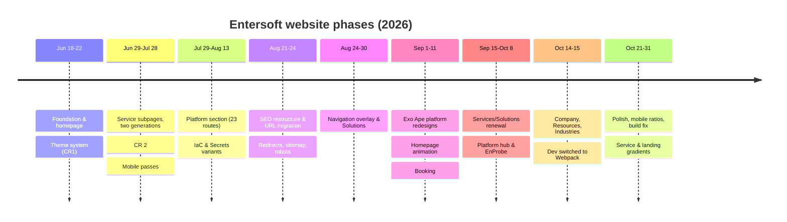
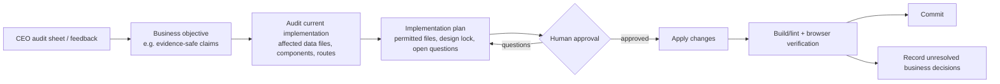

# Development History

The project's history from the scaffold (18 Jun 2026) to the current working tree (31 Oct 2026).

**Sources:** git history (74 commits on `main`), Antigravity implementation plans, Cursor chat transcripts, and the SEO content master.

**Limits:** dates are git author dates. Descriptions of each commit's purpose come from its message and the files it touched. Where a plan or chat describes the intent, that source is named.

Related: [AI_ASSISTED_DEVELOPMENT.md](AI_ASSISTED_DEVELOPMENT.md) · [TESTING_AND_DEBUGGING.md](TESTING_AND_DEBUGGING.md)

---

## 1. Repository facts

| Fact | Value |
|---|---|
| Remote | `https://github.com/Yash-Bagul01/Entersoft.git` |
| Branches | `main` only, tracking `origin/main` |
| Commits | 74, from 2026-06-18 to 2026-10-29 |
| Author identities | "Yash Bagul" (the first 2 commits) and "Yash-Bagul01" (the remaining 72). Probably the same person; not verified. |
| Stack since commit 1 | Next.js 16.2.9, React 19.2.4, TypeScript 5, Tailwind 4 |

## 2. Phases

### Phase 1: Foundation and homepage (18–22 Jun, commits 1–10)

**Scaffold.** The project started from Create Next App. It was then moved to `src/app`.

**`9392db4` "Entersoft Landing page foundation"** built the whole first homepage in one commit (51 files):
- 10 sections
- 5 layout components: Navbar, Footer, CustomCursor, GrainOverlay, SmoothScrollProvider
- 6 UI primitives
- 6 data files
- 4 hooks
- `tokens.css`
- new dependencies: GSAP, Framer Motion, Lenis, lucide, clsx, tailwind-merge

This matches the Antigravity plan "Implementation Plan – Entersoft Security Landing Page" (18 Jun).

**CR1 (`b9e9cd3`, 20 Jun)** introduced the **light/dark theme system**:
- `data-theme` on `<html>`, plus a pre-paint `localStorage` script
- token restructure, with light as the default theme (`#f6f5f0`, accent `#0077c8`)
- `ThemeToggle`

CR1.1–CR1.3 refined tokens, the Navbar, Hero, CaseStudies, Differentiators, stats, the marquee and the reduced-motion hooks. The matching plan is "Light Theme Integration" (19 Jun).

### Phase 2: Service subpages, two generations (29 Jun – 28 Jul, commits 11–31)

**First generation (`ebf61da`).** Seven service routes on a shared template: ServiceHero, Process, Deliverables, FAQ, CTA, Breadcrumb, plus 7 visuals.

**Second generation: one bespoke immersive page per service.**

| Page | Commit | Main techniques |
|---|---|---|
| AppSec | `796b4a4` | Three.js and anime.js added; Rubik's cube |
| VAPT | `27c9e4a`, `30b083a` | 3D card stack; Spline added |
| Cloud | `5335b0f` | d3-force; canvas particles, noise and waveform |
| Compliance | `94bb4b1` | `compliance-v2` |
| Smart Contract | `a2bf5c3` | Code annotator, fuzzing simulator, 3D canvas |
| AI Systems | `7209823` | 63 files, three design iterations (`ai-systems`, `-v2`, `-v3`) |
| Cyber Defence | `3cd7897` | Hands and radar WebGL scenes |

**CR 2 (`f4498f0`, 20 Jul)** was a cross-cutting revision: all 7 service pages, Navbar, Footer, Differentiators, FinalCTA, ServicesShowcase, and the new `CapabilityCard`, `ServiceHoverCard` and `differentiators.ts`. It matches the Antigravity plan **"CEO-Directed Website Changes (Batch 1)"** on the same date (see §4).

**Mobile passes** came on 21 Jul (`39aee03`, `f916061`), the same day as the plan "Full Responsive Audit & Surgical Fix".

### Phase 3: Platform section (29 Jul – 13 Aug, commits 32–37)

- **`5314ad4`** created the first platform design: `/platform` plus 8 concept pages (cyber-ontology, data-fusion, exposure-decisioning, …) on `PlatformSubpageTemplate`.
- **`69512a2`** added 15 product-module routes (sast, sca, dast, iac, secrets, aspm, api-security, container, …). It matches the plan "Align Platform Subpages with Invicti Platform Navigation".
- **`d2206b2`** added the IaC page and several Secrets design variants (Nova, Thayon).
- **`df74b6b`** reworked the track-record section. It matches the plan "3D Cylinder Scroll Animation for Validated Track Record (aikawakenichi.com reference)" (11 Aug). That plan is the origin of `TrackRecord3DCylinder`.

### Phase 4: SEO restructure and URL migration (21–24 Aug, commits 38–41)

**`8e7d2d0` "SEO + UI changes 1 (15-08-26)"** (107 files) implemented the SEO master:
- added `Entersoft_Website_SEO_Content_Master_2026.md`, `robots.ts`, `sitemap.ts` and `config/seo.ts`
- renamed the service URLs to search-intent slugs, with permanent redirects
- added the cloud-resilience hub and its 5 sub-offerings, `/platform/enprobe`, `/company/accreditations` and `/contact`
- added the Digital Trust components (DT0–DT10)

It matches the plan "Delivery Model, Credentials & Conversion Strategy Update" (21 Aug).

**`cdeff51`** turned off 11 ESLint rules (see [TESTING_AND_DEBUGGING.md](TESTING_AND_DEBUGGING.md)).

### Phase 5: Navigation overlay and Solutions (24–30 Aug, commits 42–46)

- `ExoMenuOverlay`, the full-screen menu, came from the plan "Exo Ape Styled Navbar Menu Button & Full-Screen Menu".
- The `/solutions` route and `SolutionsShowcase` were added.
- The hero background and font sizes changed.
- The plan "Performance Optimization & Smooth User Interactions" (25 Aug) covered hero video, Lenis lag smoothing and WebGL optimisation.

### Phase 6: Exo Ape platform redesigns and homepage animation (1–11 Sep, commits 47–57)

- `ExoApeCaseStudy` and `ExoMotion` were added, and DAST, IaC and Agentic Pentesting were redesigned on them.
- The attack-surface page was added.
- `DesignInMotion` (homepage) was added.
- Footer interactions were added: `DiscussProjectModal`, `FooterLineLink`, `LinedWordmark`.
- `StripeWipeBars` and `useStripeWipe` were added.
- The `/booking` placeholder was added.
- Solution transitions were added: `SolutionExpandOverlay`, `SolutionTransitionContext`.

The plans behind this phase are "Trionn-Style Dynamic Section Transitions", "Customer Outcomes Horizontal Scroll" and the two **CEO Changes Batch 4** plans (AI Systems; VAPT).

### Phase 7: Services/Solutions renewal, Platform hub, EnProbe (15 Sep – 8 Oct, commits 58–65)

- **`d747eb8` "Services page renew"** replaced the bespoke service pages with the **data-driven `ServiceCasePage`** and `ServicesReel`, and added `/solutions/[slug]` with `solutionLandings.ts`.
- **`79ae5b5`** added `PlatformHubScene`, `PlatformPageTransition` and `HeroCursor`. It matches the plan "Belenjones-Inspired 3D Cuboid Platform Hub".
- **Later commits** added:
  - `AiBomKryntPage` (plan "Redesign AI-BOM Subpage to Match Family.co Aesthetics")
  - `ManageVulnPage`
  - `EnprobeOvaPage`
  - `AutomateWorkflowsPage`
  - `OpenSourceFlowPage`
  - `TrackKpisSvzPage`
  - heavy image and video imports

### Phase 8: Company, Resources, Industries (14–15 Oct, commits 66–67)

- **`1f0c3bf`** added `company/[slug]`, `industries/[slug]`, `resources/[slug]`, `EditorialPage`, `PlatformOvaPage`, 5 data files and 127 images.
  - **Problem:** this commit also included about 1,983 `.tmp-*` files, among them **two Edge browser profiles** (1,820 files). See [KNOWN_ISSUES](KNOWN_ISSUES_AND_FUTURE_WORK.md#1-high-priority).
- **`7c73e23`** added `SolutionsWorksGallery` and **switched `dev` to `next dev --webpack`**.

### Phase 9: Polish, build fix, backgrounds (21–31 Oct, commits 68–74 + working tree)

**Commits:**
- image quality 95, mobile ratio changes
- "Defensive Philosophy changes" to the cylinder intro
- homepage cards update
- **`dc482ac` "Fix production build using Webpack"**: `"build": "next build --webpack"`. See [TESTING_AND_DEBUGGING.md §3.1](TESTING_AND_DEBUGGING.md#31-production-build-timed-out-under-turbopack).
- **`25b0002` "services subpage background change"**:
  - animated Grainient-inspired gradients for Protocol Assurance (`sc-galactic`) and AI Systems Assurance (`sc-prism`) in `solution-case.css` (+293 lines)
  - per-service background colours
  - `allowedDevOrigins: ['*.trycloudflare.com']`

**Uncommitted work (31 Oct):**
- `LandingGradient` and its CSS: a viewport-anchored animated background behind homepage sections 2–8, in both themes
- light-theme continuity overrides
- dark-theme fixes:
  - Work in Motion visibility
  - Desk Brief cards
  - "Our practice" panel set to navy `#0a1038`
  - Certifications fading smoothly into the footer black
- this `docs/` set and the new `README.md`

## 3. Commit log (complete)

| # | Hash | Date | Message | Main areas |
|---|---|---|---|---|
| 1 | 345e48e | 06-18 | Initial commit from Create Next App | scaffold |
| 2 | 9392db4 | 06-18 | Entersoft Landing page foundation | homepage, layout, ui, data, hooks, tokens |
| 3 | 45bf7b0 | 06-18 | Refine Entersoft design tokens | tokens.css |
| 4 | f137577 | 06-18 | Video changes | hero |
| 5 | d1c0e56 | 06-19 | Logo Insertion | navbar/footer |
| 6 | b9e9cd3 | 06-20 | CR1 | theme system, ThemeToggle |
| 7 | 5d6c95f | 06-20 | CR1.1 | tokens |
| 8 | b0ef388 | 06-20 | CR1.2 | navbar, hero, sections |
| 9 | 8d53b4e | 06-21 | CR1.3 | marquee, label, toggle, hooks |
| 10 | 70176d4 | 06-22 | navbar button change | navbar |
| 11 | ebf61da | 06-29 | Services Subpages | 7 service routes + template |
| 12 | 796b4a4 | 07-01 | Appsec Page | AppSecPlatformPage, RubiksCube3D (three, animejs) |
| 13–17 | 214b341 … 3f9f7ae | 07-02 – 07-07 | Appsec page updates 1 – 1.4 (SEO) | `config/routes.ts`, image remotePatterns |
| 18–19 | 27c9e4a, 30b083a | 07-08 – 07-09 | VAPT page + update | VAPTHero (Spline added) |
| 20 | 5335b0f | 07-10 | Cloud Security page | cloud-v2 canvases (d3-force) |
| 21 | 94bb4b1 | 07-14 | Compliance Management Page | compliance-v2; CLAUDE.md removed |
| 22 | 0b27d7c | 07-14 | Cloud Security mobile update | responsive |
| 23 | a2bf5c3 | 07-15 | Smart contract service page | smart-contract-v2 |
| 24 | f4498f0 | 07-20 | CR 2 | services, nav, sections (CEO Batch 1) |
| 25–26 | 39aee03, f916061 | 07-21 | Mobile Version Changes 1–2 | responsive |
| 27 | 7209823 | 07-23 | AI systems service page | ai-systems v1–v3 |
| 28 | c5a1cc5 | 07-24 | Changes with cursor | CustomCursor, useCursor, canvases |
| 29 | 3cd7897 | 07-24 | Cyber defence service page | cyber-defense WebGL |
| 30 | 6cd647e | 07-28 | changes in main landing page and others | homepage |
| 31 | ef3286c | 07-28 | AI ast page | ai-zkpass |
| 32 | 5314ad4 | 07-29 | New Sub pages-Platform | platform v1 (8 concept routes) |
| 33 | 69512a2 | 08-04 | Platform section changes | 15 module routes |
| 34 | 3ab2e55 | 08-05 | Platform section change 2 | SBOM |
| 35 | aafffe8 | 08-06 | Main landing page changes | homepage |
| 36 | d2206b2 | 08-12 | Main + IaC subpage | IaC, Secrets variants |
| 37 | df74b6b | 08-13 | main changes in validated track record section | track record |
| 38 | 8e7d2d0 | 08-21 | SEO + UI changes 1 (15-08-26) | SEO master, redirects, sitemap, robots |
| 39 | 269c41b | 08-23 | Main Landing page hero section changes | FluidPreloader |
| 40–41 | 1751df0, cdeff51 | 08-24 | Main Landing issue solve 1–2 | ESLint rules relaxed |
| 42–43 | 8d311d2, 93d3e28 | 08-24 | navbar changes / issue solve | ExoMenuOverlay |
| 44–45 | a09d170, a51f876 | 08-25 | navbar-solution changes; Solutions page update | `/solutions` |
| 46 | 998cb38 | 08-30 | Hero background and font size change | hero |
| 47 | 0a8446f | 09-01 | Iac and DAST | ExoApeCaseStudy, ExoMotion |
| 48–49 | db812ff, 3f2c92e | 09-02 – 09-03 | Agentic pentesting (+update) | ExoApe |
| 50 | 9142e40 | 09-06 | update changes | services, platform, data |
| 51 | 119686d | 09-08 | main landing page animations update | DesignInMotion |
| 52 | cd43c7d | 09-08 | Surface visibility subpage change | ASM, footer interactions, stripe wipe |
| 53–55 | 9a22eac, fda5060, 49fd0bb | 09-08 – 09-09 | Main landing page changes 1–3 | `/booking` |
| 56 | 0512583 | 09-10 | Solutions page update | solution transitions |
| 57 | 5cf03ae | 09-11 | updates | misc |
| 58 | 544b09d | 09-15 | hero section video update | hero |
| 59 | d747eb8 | 09-16 | Services page renew | ServiceCasePage, ServicesReel, `/solutions/[slug]` |
| 60 | 79ae5b5 | 09-16 | platform new page and main update | PlatformHubScene, page transitions, HeroCursor |
| 61 | 99435b1 | 09-17 | Platform page animation update | EnProbe |
| 62 | 35e17f6 | 09-22 | Solutions and platform changes | AI-BOM, API discovery |
| 63 | b249062 | 09-24 | AI BOM subpage | AiBomKryntPage, ManageVulnPage |
| 64 | e2eb1b0 | 10-06 | Enprobe page updated | EnprobeOvaPage, AutomateWorkflows |
| 65 | d8aa218 | 10-08 | solutions track appsec subpage | OpenSourceFlow, TrackKpis |
| 66 | 1f0c3bf | 10-14 | New pages, resources, company and its subpages | editorial routes, PlatformOvaPage (+ .tmp artifacts) |
| 67 | 7c73e23 | 10-15 | update in services page and solutions page | SolutionsWorksGallery; dev → webpack |
| 68 | c84c8dc | 10-21 | images changes in the main | images, quality 95 |
| 69 | c1e5f15 | 10-22 | mobile ratio changes | responsive |
| 70 | b58deaf | 10-22 | Defensive Philosophy changes | track record intro |
| 71 | f1fe64b | 10-26 | main landing page update cards 6 | outcome cards |
| 72 | 64cba20 | 10-28 | new changes | platform, services, solutions, data |
| 73 | dc482ac | 10-28 | Fix production build using Webpack | package.json |
| 74 | 25b0002 | 10-29 | services subpage background change | galactic/prism gradients, allowedDevOrigins |

## 4. CEO-directed change batches

The project uses the label **CEO feedback**. Records exist for the following:

| Batch | Date | Scope (from plan headings) | Code consequence |
|---|---|---|---|
| CR1 – CR1.3 | 20–21 Jun | Theme, hero, navbar, sections | Light/dark system; light became the default |
| **CEO Batch 1** ("CEO-Directed Website Changes") | 20 Jul | Renamed "Our Assurance System" to "Our Cyber Assurance System"; renamed the 7 services (plain plus branded names); mega-dropdown labels; inter-service navigation; breadcrumbs and headings | `services.ts` restructured into the `Service` type with `plainLanguageTitle`/`displayName`. ServicesShowcase rewritten (text scramble, `ScrollTrigger.batch`, hover card). Navbar labels changed after explicit approval. Commit `f4498f0` "CR 2". |
| Delivery model and credentials | 21 Aug | 5-step delivery lifecycle, delivery-model badges, service-specific CTAs, accreditation and research integrity | `DeliveryModelBadge`, the cloud-resilience offerings, the accreditations page, and the SEO commit `8e7d2d0` |
| **CEO Batch 4: AI Systems Assurance** | 4 Sep | Data and claim corrections, component corrections, SEO | Changes listed below |
| **CEO Batch 4: VAPT** | 6 Sep | Naming, jargon, removing absolute claims, a 10-step methodology, framework alignment | Changes listed below |

**CEO Batch 4: AI Systems Assurance.** In `aiZkpass.ts` and `services.ts`, these claims were replaced:

| Removed claim | Replaced with |
|---|---|
| "600+ AI systems assessed" | "Scope-Defined" |
| "0 False Positives" | "Human-Validated" |
| "98.6% noise elimination" | "Rule-Tuned" |
| "847→12" signal reduction | "Analyst-Triage / Signal Prioritisation" |

The CTA link was also fixed (`/#contact` → `/contact`).

**CEO Batch 4: VAPT.**
- **Naming:** the title became "Penetration Testing and Adversarial Validation".
- **Jargon removed:**

  | Before | After |
  |---|---|
  | "High Critical Expose" | "High & Critical Risk Focus" |
  | "Privileged Leak Vectors" | "Privilege Escalation Vectors" |
  | "Zero-Day Architectures" | "Architectural & Logic Flaws" |

- **Claims:** "0% false positives" became "Human-Validated Findings".
- **Methodology:** a 10-step lifecycle.
- **Framework alignment:** OWASP, PTES, NIST SP 800-115, OSSTMM, CREST and CERT-In.

Every CEO batch plan carries a **design-lock rule**: *"Do NOT redesign or visually restructure anything."* The batches changed content, claims, metadata and CTAs inside the existing designs.

**Batches 2 and 3:** no plans titled "Batch 2" or "Batch 3" were found. They may live in unread Antigravity conversations or other records, so they are **unverified**.

### Feedback workflow (as practised)

## 5. Key engineering decisions

| Decision | When | Why (from evidence) | Consequence |
|---|---|---|---|
| Next 16 App Router + Tailwind 4 from day one | Jun | Scaffold choice | CSS-first Tailwind config and async `params`. `AGENTS.md` warns agents about the breaking changes. |
| Lenis inside the `gsap.ticker` clock | Jun (foundation) | Code comment: "prevent desync rubber-banding" | Every scroll animation shares one clock |
| Light theme as default with a `data-theme` attribute | CR1, Jun | CEO change request | Hundreds of theme overrides in `globals.css` |
| One bespoke page per service, later replaced by a data-driven template | Jul → Sep 16 | The bespoke pages were expensive to keep consistent and to correct (CEO batches touched each one separately) | The old pages remain on disk, but their URLs redirect |
| Search-intent URLs with permanent redirects | 21 Aug | SEO master | Legacy routes remain as dead files |
| Single canonical host (`PRODUCTION_URL`) and noindex off-production | Aug | SEO master release checklist | Preview deploys are not indexed, provided `NEXT_PUBLIC_APP_URL` is set |
| Hand-built pins instead of ScrollTrigger `pin` for overlapping sections | Sep–Oct | Sections slide over each other with `-mt-[100vh]`; ScrollTrigger's pin spacers fought the overlap | `gsap.ticker` drive functions (see the animations doc) |
| Webpack instead of Turbopack | 15 Oct (dev), 28 Oct (build) | Turbopack timed out processing `globals.css` | `--webpack` in both scripts |
| Viewport-anchored landing gradient instead of `position: fixed` | 31 Oct | GSAP transforms break `fixed`; `overflow-x: hidden` breaks `sticky` | JS-written `--lg-y` per section |

## 6. Debugging history (summary)

The full problem → cause → fix records are in [TESTING_AND_DEBUGGING.md](TESTING_AND_DEBUGGING.md#3-debugging-history). Main entries:
- Turbopack build timeout.
- Long dev recompiles after `globals.css` edits.
- A GSAP inline style overriding the CSS theme.
- ScrollTrigger measuring before pins settled.
- A transient "LandingGradient is not defined" error.
- PowerShell `&&` and quoting problems.
- The shell's working directory drifting after a `cd`.
