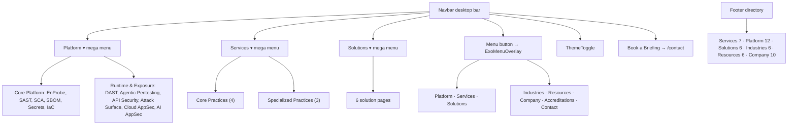

# Pages and Features

This document covers four things: the full route inventory, how the site is navigated, each page family in detail, and the business positioning behind them.

Related: [PROJECT_ARCHITECTURE.md](PROJECT_ARCHITECTURE.md) · [SEO_SECURITY_AND_DEPLOYMENT.md](SEO_SECURITY_AND_DEPLOYMENT.md) · [CYBERSECURITY_DOMAIN.md](CYBERSECURITY_DOMAIN.md)

---

## 1. Business positioning represented in the site

This section uses two sources: the approved copy master, `Entersoft_Website_SEO_Content_Master_2026.md` (Implementation edition, 15 Aug 2026), and the live copy.

- **Core message:** "Application-first cyber assurance for modern enterprises." This is the homepage H1.
- **One operating model, three ways to buy assurance:**

  | Offering | What it is | Where it lives on the site |
  |---|---|---|
  | **EnProbe platform** | Continuous visibility, prioritisation and evidence | `/platform/*` |
  | **Expert security practices** | Human validation where automation reaches its limits | `/services/*` |
  | **Enterprise security programmes** | Outcome-based combinations of the platform and practices | `/solutions/*` |

- **Lifecycle language:** Discover → Contextualise → Validate → Remediate → Prove. On the homepage "Our practice" panel this is condensed to FIND / VALIDATE / REMEDIATE / VERIFY.
- **Differentiators:** exploitability over severity alone, human-validated findings, remediation that fits delivery teams, and "closure, not report delivery".
- **Proof strip:** Since 2013, CREST-accredited penetration testing, CERT-In empanelled, and an ISO/IEC 27001-certified ISMS.
- **Brand split as stated on the site:**
  - *"EnProbe finds the exposure. Entersoft experts validate it and stay with the fix."* (`Footer.tsx`)
  - *"EnProbe is an exposure-assurance platform… AI assists. Evidence decides."* (`enprobeOva.ts`)
  - The EnProbe CTAs link to the separate product site `https://enprobe.io`.
- **Naming convention for services:** each service has a plain-language search name and an Entersoft branded descriptor. They are defined in `src/data/services.ts`:

| Plain-language name | Branded descriptor | Live route |
|---|---|---|
| Application and Product Security | Application Assurance | `/services/application-security-testing` |
| Penetration Testing and Red Teaming | Adversarial Validation | `/services/penetration-testing` |
| Cloud, Identity and Platform Security | Cloud Resilience | `/services/cloud-security` |
| GRC, Privacy and Audit Readiness | Digital Trust | `/services/grc-compliance-privacy` |
| MDR, SIEM and Detection Engineering | Cyber Defense Operations | `/services/managed-detection-response` |
| Smart Contract and Web3 Security | Protocol Assurance | `/services/smart-contract-security` |
| AI and Agentic-System Security | AI Systems Assurance | `/services/ai-security-testing` |

The copy master's publishing rules include:
- Use "Since 2013" rather than a year count.
- Say "human-validated findings", never "zero false positives".
- Label demos as illustrative.
- Give the scope and a verification link for every accreditation.
- Make no "GDPR or SOC 2 compliant" claims without evidence.

Some live copy still breaks these rules; the cases are listed in [KNOWN_ISSUES_AND_FUTURE_WORK.md §4](KNOWN_ISSUES_AND_FUTURE_WORK.md#4-business-content-requiring-approval).

---

## 2. Homepage

Route `/`. `src/app/page.tsx` does three things:
- exports static `metadata` (canonical `/`);
- injects Organization, WebSite and WebPage JSON-LD (built from `src/config/seo.ts`) through `next/script` with `id="home-jsonld"`;
- renders the sections in the table below, in this order. All of them are static imports.

| # | Section (`id`) | Component | What the user sees | Main interaction / animation | Data |
|---|---|---|---|---|---|
| 1 | `hero` | `Hero.tsx` + `HeroCursor.tsx` | Full-viewport autoplay video (S3), the H1, a credentials line, and two CTAs: "Book a Security Briefing" and "Explore EnProbe". A "SCROLL" cue. | ScrollTrigger pin `+=300px`, scrub 0.4. The H1 fades out and a statement paragraph fades in. The video is retried on first interaction. Frosted lerp cursor. | inline |
| 2 | `track-record` | `StatsCounter` → `TrackRecord3DCylinder.tsx` | "Defensive philosophy" word reveal, then a WebGL cylinder of glass cards ("Defense Measured in Certainty") with an "ENTERSOFT" watermark | Pin `1200px + 100vh`, scrub 0.6. Three phases: reveal, unroll, rotate. Drag or buttons rotate it. Mouse tilt. | inline `CARDS_DATA` |
| 3 | `services` | `ServicesShowcase.tsx` | "Enterprise Services": a large list of 7 service names, plus an image stack and caption | Hover (fine pointer) or tap (touch) selects; click starts the column-wipe transition. Slides over the previous pin (`md:-mt-[100vh]`). | `services.ts` |
| 4 | `capabilities` | `Differentiators.tsx` | "Why Enterprises chose Entersoft": 6 outcome cards on a horizontal track, then the "Our practice" FIND / VALIDATE / REMEDIATE / VERIFY panel | Custom pin with horizontal travel. Cards rise with smoothstep. Panel colour is interpolated. | `differentiators.ts` |
| 5 | `operational-validation` | `Testimonials.tsx` | Client list, quote, avatar, "Become a Client" | 6-bar stripe wipe and sheet slide (desktop). Auto-advances every 5s while ≥35% visible. | `testimonials.ts` (first 5) |
| 6 | `design-in-motion` | `DesignInMotion.tsx` | "Work in / Motion": 6 service cards on a dashed arc, which unfold into a grid | Custom pin at 3.4 × viewport height. Wheel-to-grid interpolation. Click a landed card to flip it. | `services.ts` (first 6) |
| 7 | `insights` | `InsightsBlog.tsx` | "Threat Intelligence Desk Briefs (03)": three portrait cards | Staggered title-line reveal. Desktop: cards rise, stack and shrink into a row. Mobile: a static list. | `blog.ts` |
| 8 | `certifications` | `CertificationsMarquee.tsx` | "Accredited Security Compliance": 4 credentials (CERT-In, CREST, ISO 27001, GDPR), a logo row, "View credentials" | Stripe wipe. The footer scales this sheet to 0.9 as it rises. In dark theme the panel fades from blue into the footer black. | `certifications.ts` |

Two `AnimatedDivider`s sit between groups.

**Shared homepage background.** `LandingGradient` (`tone="theme"`) runs behind sections 2–8. It uses one viewport-anchored animated gradient so that adjacent sections look continuous:
- **Light theme:** pale lavender.
- **Dark theme:** deep blue.

This work is uncommitted as of 31 Oct 2026; see [UI_UX_DESIGN_SYSTEM.md §4](UI_UX_DESIGN_SYSTEM.md#4-background-system-and-the-landing-gradient).

**Unmounted section components:**
- `ValueProposition` and `CaseStudies` are unused.
- `FinalCTA` is used only on `/contact`.

---

## 3. Complete route inventory

Status values:
- **Current:** a live page.
- **Alias (307):** `redirect()` inside the page file.
- **Legacy (308):** the URL is redirected in `next.config.ts`, so the page file never renders.
- **Placeholder:** a stub page.

### 3.1 Services

| Route | Component | Layout | Metadata / canonical | JSON-LD | Status |
|---|---|---|---|---|---|
| `/services` | `ServicesReel` | services layout (dark) | static, self | — | Current hub (footer hidden) |
| `/services/application-security-testing` | `ServiceCasePage slug="appsec"` | services (case mode) | static + OG/Twitter, self | BreadcrumbList + FAQPage | Current |
| `/services/penetration-testing` | `ServiceCasePage slug="vapt"` | services | self | BreadcrumbList | Current |
| `/services/cloud-security` | `ServiceCasePage slug="cloud-resilience"` | services | self | BreadcrumbList | Current |
| `/services/grc-compliance-privacy` | `ServiceCasePage slug="compliance-management"` | services | self | BreadcrumbList | Current |
| `/services/managed-detection-response` | `ServiceCasePage slug="siem"` | services | self | BreadcrumbList | Current |
| `/services/smart-contract-security` | `ServiceCasePage slug="smart-contract-audits"` | services | self | BreadcrumbList | Current |
| `/services/ai-security-testing` | `ServiceCasePage slug="ai-ast"` | services | self | BreadcrumbList | Current |
| `/services/cloud-resilience/assessment` | `CloudOfferingLayout` + `cloudOfferings.assessment` | services ("Explore Services" bar) | self | Org + WebPage + Service + Breadcrumb | Current, but **orphaned** (see 3.7) |
| `/services/cloud-resilience/penetration-testing` | same pattern | same | self | same | Current, orphaned |
| `/services/cloud-resilience/posture-management` | same | same | self | same | Current, orphaned |
| `/services/cloud-resilience/managed-detection` | same | same | self | same | Current, orphaned |
| `/services/cloud-resilience/containers-iac` | same | same | self | same | Current, orphaned |
| `/services/appsec` | `AppSecPlatformPage` | — | → application-security-testing | full graph | Legacy (308) |
| `/services/vapt` | inline client page + `VAPTHero` | `vapt/layout.tsx` | → penetration-testing | full graph | Legacy (308) |
| `/services/cloud-resilience` | `CloudResilienceHubRoot` | — | self | full graph | Legacy (308 → cloud-security) |
| `/services/compliance-management` | `CompliancePageRoot` | — | → grc-compliance-privacy | full graph | Legacy (308) |
| `/services/siem` | `CDPageRoot` | — | → managed-detection-response | full graph | Legacy (308) |
| `/services/smart-contract-audits` | `SmartContractPageRoot` | — | → smart-contract-security | full graph | Legacy (308) |
| `/services/ai-ast` | `AZPageRoot` | — | → ai-security-testing | seo.ts nodes | Legacy (308) |
| `/services/managed-cloud-security` | `redirect("/services/cloud-resilience")` | — | — | — | Alias (307, then 308: two hops) |

### 3.2 Platform (EnProbe)

| Route | Component | Data | Canonical | Status |
|---|---|---|---|---|
| `/platform` | `PlatformHubScene` | `platformHub.ts` (16 items) | **none** | Current hub (light, footer hidden, not in sitemap) |
| `/platform/enprobe` | `EnprobeOvaPage` | `enprobeOva.ts` | self + SoftwareApplication JSON-LD | Current (not in sitemap) |
| `/platform/sast` | `PlatformOvaPage` | `SAST_OVA` | none | Current |
| `/platform/sca` | `PlatformOvaPage` | `SCA_OVA` | none | Current |
| `/platform/sbom-license-risk` | `PlatformOvaPage` | `SBOM_OVA` | none | Current |
| `/platform/secrets` | `PlatformOvaPage` | `SECRETS_OVA` | none | Current |
| `/platform/iac` | `PlatformOvaPage` | `IAC_OVA` | none | Current |
| `/platform/dast` | `DastExoapePage` → `ExoApeCaseStudy` | `dastCase.ts` | none | Current |
| `/platform/agentic-pentesting` | `AgenticPentestingExoapePage` → `ExoApeCaseStudy` | `agenticCase.ts` | none | Current |
| `/platform/api-security` | `ApiPageRoot` → `ExoApeCaseStudy` | `apiCase.ts` | self | Current |
| `/platform/attack-surface-management` | `AsmPageRoot` → `ExoApeCaseStudy` | `asmCase.ts` | self | Current |
| `/platform/cloud-appsec` | `ExoApeCaseStudy` | `cloudCase.ts` | self | Current |
| `/platform/ai-appsec` | `ExoApeCaseStudy` | `aiCase.ts` | self | Current |
| `/platform/aspm` | `ExposureDecisioningRoot` | inline | none | Current (not in nav) |
| `/platform/container` | `PlatformSubpageTemplate` | `platformPillars.container` | none | Current (not in nav) |
| `/platform/compliance-reporting` | `PlatformSubpageTemplate` | `platformPillars["compliance-reporting"]` | none | Current (not in nav) |
| `/platform/threat-intelligence` | `PlatformSubpageTemplate` | `platformPillars["threat-intelligence"]` | none | Current (not in nav) |
| `/platform/cyber-ontology` | → `/platform/sast` | — | — | Alias (307) |
| `/platform/data-fusion` | → `/platform/sca` | — | — | Alias (307) |
| `/platform/exposure-decisioning` | → `/platform/aspm` | — | — | Alias (307) |
| `/platform/threat-operations` | → `/platform/threat-intelligence` | — | — | Alias (307) |
| `/platform/expert-governed-ai` | → `/platform/ai-appsec` | — | — | Alias (307) |
| `/platform/closed-loop-remediation` | → `/platform/dast` | — | — | Alias (307) |
| `/platform/continuous-assurance` | → `/platform/compliance-reporting` | — | — | Alias (307) |
| `/platform/command-view` | → `/platform/cloud-appsec` | — | — | Alias (307) |

The eight aliases preserve URLs from the first platform design (29 Jul 2026), which was replaced in August.

### 3.3 Solutions

All six pages are generated from `SOLUTION_LANDINGS`. The solutions layout forces the light theme.

| Route | Component | Hero title |
|---|---|---|
| `/solutions` | `SolutionsWorksGallery` (spiral of 6 cards, footer hidden) | — |
| `/solutions/api-discovery` | `ApiDiscoveryPortalPage` (+ `PhoneMock`) | "See every API your software actually exposes" |
| `/solutions/ai-bom` | `AiBomKryntPage` | "See every AI component in your software" |
| `/solutions/manage-vulnerabilities` | `ManageVulnPage` | "See, prioritize and reduce AppSec risk in one place" |
| `/solutions/automate-security-workflows` | `AutomateWorkflowsPage` | "Move security work into the pipelines you already run" |
| `/solutions/track-appsec-kpis` | `TrackKpisSvzPage` | "Show the board what AppSec is actually changing" |
| `/solutions/manage-open-source-risk` | `OpenSourceFlowPage` | "Know what you inherited — and whether you can ship it" |

### 3.4 Company, industries, resources (`EditorialPage`)

| Route | Slugs (source) |
|---|---|
| `/company/[slug]` | `about`, `team`, `clients`, `partners`, `awards`, `responsible-disclosures`, `consulting`, `careers` (`companyPages.ts`) |
| `/company/accreditations` | Static page: CREST, CERT-In and ISO/IEC 27001 cards, a privacy note, and Organization JSON-LD with `hasCredential` |
| `/company` | 308 → `/company/accreditations` |
| `/industries/[slug]` | `fintech-security`, `e-commerce`, `it-saas`, `industrial-iot`, `blockchain`, `health-tech` (`industries.ts`) |
| `/resources/[slug]` | `blog`, `media`, `faq`, `events`, `webinars`, `hackfest` (`resourceNav` in `resources.ts`; content in the inline `resourceDocs` in the route file) |

### 3.5 Conversion and SEO routes

| Route | Component | Status |
|---|---|---|
| `/contact` | `FinalCTA`: a form with name, email, phone, discovery source, service pills and details | **Partial**: shows a success state after a 1.2s timer and sends no data. Includes an external Google Calendar booking link. |
| `/booking` | `<h1>Booking</h1>` | **Placeholder**, `noindex`. It is linked from the footer and the Discuss modal. |
| `/sitemap.xml` | `src/app/sitemap.ts` | About 58 entries; see [SEO doc](SEO_SECURITY_AND_DEPLOYMENT.md#16-sitemap-and-robots) |
| `/robots.txt` | `src/app/robots.ts` | `disallow: /` off-production |

### 3.6 Dynamic and nested route summary
- **Dynamic routes:** `solutions/[slug]`, `company/[slug]`, `industries/[slug]`, `resources/[slug]`. Each one uses `generateStaticParams` with `dynamicParams = false`, and calls `notFound()` for unknown slugs.
- **Nested static routes:** `services/cloud-resilience/*` (5 pages).
- **Route aliases:** 9 page-level 307 redirects and 8 config-level 308 redirects.

### 3.7 Broken or outdated references

| Reference | Source | Result |
|---|---|---|
| `/services/cloud-security/{assessment, penetration-testing, posture-management, managed-detection, containers-iac}` | `ROUTES.services.cloudResilience` (`src/config/routes.ts` lines 73–80). Used by `serviceCaseCopy.ts` ("Where it fits" on the live cloud page) and `sitemap.ts` | **404.** The pages actually live at `/services/cloud-resilience/*`. |
| `/services/appsec` and other legacy slugs | `PlatformSubpageTemplate` "where it fits" links (`platform.ts` `serviceHref`) | Work, but go through an extra redirect |
| `/about`, `/careers`, `/privacy` | `LightFooter.tsx` | Would 404, but `LightFooter` is not rendered on any live route |
| `/booking` | Footer, Discuss modal, Events resource CTA | Resolves, but the page is a placeholder |
| Breadcrumb parent `/services/cloud-resilience` | Cloud sub-pages | The parent URL redirects |

---

## 4. Navigation architecture



### Navbar (`src/components/layout/Navbar.tsx`)
- **Data:** `navItems` is built from `ROUTES`, `industryNav`, `resourceNav` and `companyNav`.
- **Desktop bar:** shows the first three items (Platform, Services, Solutions). Each mega menu opens on `mouseenter` and closes on `mouseleave`.
- **Variants:**
  - transparent over the hero;
  - a floating glass pill once the bottom of `#hero` scrolls past 120px;
  - per-route light or dark chrome, chosen by about 15 pathname flags.
- **Theme toggle:** hidden on routes that force a theme (services, platform, solutions).
- **Mobile:** the Menu button opens `ExoMenuOverlay`. An older mobile accordion still exists in the file, but nothing can open it.

### ExoMenuOverlay (`src/components/layout/ExoMenuOverlay.tsx`)
- Full-screen `role="dialog"` with `aria-modal`.
- Opens with a staggered grid-cell wipe in `#1a1c1a`.
- Flyouts open on hover or focus. On screens ≤767px the first tap opens the flyout.
- Escape closes the menu, and body scroll is locked while it is open.

### Footer (`src/components/layout/Footer.tsx`)
- **Visibility:** hidden on the `/platform`, `/solutions` and `/services` hubs.
- **Reveal:** a ScrollTrigger animation. The previous section's sheet scales to 0.9 while the footer sheet rises.
- **Content:**
  - "Ready to close risk that matters?" with two `FooterLineLink` actions: "Discuss your project" (opens the modal) and "Book a 30-minute call" (`/booking`).
  - A six-column link directory.
  - Social links.
  - An IST clock.
  - The canvas `LinedWordmark`.

### Cross-section relationships
- **Services ↔ Platform:**
  - Service pages show EnProbe as the evidence layer.
  - `PlatformSubpageTemplate` has a "where it fits" grid that links each platform capability to the service practices it powers.
  - Cloud sub-pages label each offering as "EnProbe platform subscription" or "EnProbe-assisted" with a `DeliveryModelBadge`.
- **Solutions ↔ Platform:** solution pages describe outcomes and name EnProbe capabilities (for example, SBOM generation in CycloneDX and SPDX).
- **Homepage → everything:** Services Showcase and Design in Motion lead to the services; the Hero CTA leads to EnProbe; Desk Briefs lead to service pages.

---

## 5. Services pages in detail

### 5.1 `ServicesReel` hub (`/services`)
- **Cards:** built from `SERVICE_CASE_ORDER` and `SERVICE_CASES`.
- **Motion:** the cards are dealt like a deck, sweep into an arc, then settle into an infinite reel.
- **Navigation:**
  - each wheel gesture or arrow key moves exactly one card;
  - clicking the active card starts the image-expand transition (`SolutionTransitionContext.startFromCard`) and then calls `router.push`;
  - in production builds every service route is prefetched.

### 5.2 `ServiceCasePage` template
Section order:
1. Hero (cover colour, emblem, title)
2. Per-service animated background after the hero
3. Intro and tags
4. "Direction" text
5. Gallery
6. Split section (stats, pillars or threats)
7. Process steps
8. Wide image
9. "Where it fits" (links or an FAQ accordion)
10. "See more projects" cards
11. Credentials row (`certifications.ts`)

The animated background in step 2 depends on the service. The two newest are for Smart Contract Security and AI Security Testing:

| Service | Gradient treatment | Background colour |
|---|---|---|
| Smart Contract Security | "Galactic" (`sc-afterhero--galactic`) | `#000104` |
| AI Security Testing | "Prism" (`sc-afterhero--prism`) | `#05061f` |

Both gradient treatments are in `solution-case.css`, and the background colours are set in `src/app/services/layout.tsx`.

Copy is assembled per service in `serviceCaseCopy.ts` from these sources:

| Service slug | Copy source |
|---|---|
| appsec, vapt, smart-contract-audits | `servicePagesData` |
| cloud-resilience | `cloudResilienceHubData` |
| compliance-management | `digitalTrustData` |
| siem | `cyberDefense.ts` |
| ai-ast | `aiZkpass.ts` |

**Known copy issue:** labels left over from the agency-portfolio design reference ("Art Direction", "Creative Process", "See more projects") appear on every service page.

### 5.3 Cloud sub-pages (`/services/cloud-resilience/*`)
`CloudOfferingLayout` renders one offering from `cloudOfferings`. Each page has:
- a delivery-model badge;
- an engagement-boundary panel (what is and isn't in scope);
- a sibling navigation bar (`CloudSiblingNav`).

---

## 6. Platform pages in detail

### 6.1 Hub (`PlatformHubScene`)
- **Layout:** a CSS-3D cube whose faces cycle through the 16 module images and videos, next to a module name list (`<nav aria-label="Platform modules">`).
- **Navigation:** clicking a module runs the media-expand transition, then calls `router.push`.
- **Scroll:** Lenis is stopped and page overflow is locked while the hub is mounted. The hub works like a full-screen app.

### 6.2 OVA template (SAST, SCA, SBOM, Secrets, IaC)
Data comes from `PlatformOvaPageData` in `platformOva.ts`. The page runs in this order:
1. A hero with a cycling word.
2. A pinned run of 6 "sectors" with an index rail. Wheel input snaps exactly one step at a time (`lenis.scrollTo`).
3. A manifesto with a carousel of 4 verbs.
4. A "Since…" close with 3 about blocks. Each outgoing section recedes (scale 0.92, `brightness(0.52)`).

### 6.3 EnProbe overview (`EnprobeOvaPage`)
- Uses the same OVA structure, with 8 sectors: Asset intelligence, ASPM, CSPM, Compound exposure, Operating loop, Runtime fabric, Tenant-safe, Verified retest.
- The verb carousel cycles Assures / Discovers / Correlates / Proves.
- The CTAs link to `https://enprobe.io`.

### 6.4 ExoApe case-study template (DAST, Agentic Pentesting, API, ASM, Cloud AppSec, AI AppSec)
Data is an `ExoApeCase` (`exoape/types.ts`). Sections:
1. Hero (with optional video)
2. Objective
3. Exploding image collage (`h-[320vh]`)
4. Solution
5. Inset wide image
6. Beliefs
7. "Anticipate" cards
8. Process rail
9. Specs
10. Partnership and quote
11. Statement and mockup
12. Recognition
13. FAQ
14. "Next" card

Reveals use `ExoMotion` `Reveal` and `Fade` (GSAP, once-only).

### 6.5 `PlatformSubpageTemplate` (Container, Compliance Reporting, Threat Intelligence)
- **Data:** a `PlatformPillar` with `whatItDoes`, `howItWorks` and `whereItFits`.
- **Navigation:** a fixed RETURN / NEXT bar.
- **Service links:** a "where it fits" grid links each capability to the service practices it supports.

### 6.6 ASPM (`ExposureDecisioningRoot`)
- **Visual:** a live attack-path visualiser (`AttackPathVisualizer`).
- **Naming mismatch:** the metadata title is "Vulnerability Management (ASPM)", but the H1 is "Exposure Decisioning".

---

## 7. Solutions pages in detail

Each solution page is a separate design built on its own stylesheet. All six share three things:
- `SolutionArrivalMarker`, which tells the transition context the page has arrived;
- `SolutionLanding` data for the hero and problem copy;
- the light-theme layout.

Notable features:

| Page | Distinctive implementation |
|---|---|
| API Discovery | `PhoneMock` device frame; CSS bob, drift and wobble keyframes |
| AI-BOM | Long-form sections styled after a Krynt reference (`ai-bom-krynt.css`) |
| Manage Vulnerabilities | Hero video, staged image reveals |
| Automate Security Workflows | Hero video, workflow steps |
| Track AppSec KPIs | Drifting hero (`tk-hero-drift`), marquee, rAF-driven effects |
| Manage Open-Source Risk | `gsap.matchMedia` desktop pin, scrubbed hero scale, infinite clip-path (`inset()`) slideshow |

The hub (`SolutionsWorksGallery`) arranges the 6 cards on a spiral (`TWIST = 0.96 rad`). Clicking a card expands its image to full screen; see [ANIMATIONS_AND_INTERACTIONS.md §8](ANIMATIONS_AND_INTERACTIONS.md#8-page-transitions).

---

## 8. Forms and interactions

| Form | Location | Fields | Validation | Submit behaviour | Status |
|---|---|---|---|---|---|
| Contact | `FinalCTA` on `/contact` | name\*, email\*, phone, discovery source, service pills (state only), project details | HTML `required` and `type=email`, plus a JS presence check | `setTimeout(1200)` then shows a success state. **No network request.** | Partially implemented |
| Discuss your project | `DiscussProjectModal` (footer) | name\*, email\*, service (custom list), details\* (≥20 chars), budget | `required`, `minLength`, JS re-check | `setTimeout(900)` then a success state, with a `mailto:` fallback | Partially implemented |
| Solution demo | `SolutionDemoForm` | name, work email, company | `required` | simulated | Legacy (not rendered) |

The form submission flow (in `FinalCTA.tsx`) is shown below. To connect it to a backend, replace the `setTimeout` with a `fetch` to a Route Handler or Server Action that validates on the server.

```48:57:src/components/sections/FinalCTA.tsx
  const handleSubmit = (e: Event) => {
    e.preventDefault();
    if (isSubmitting || !email || !name) return;

    setIsSubmitting(true);
    setTimeout(() => {
      setIsSubmitting(false);
      setSubmitted(true);
    }, 1200);
  };
```
