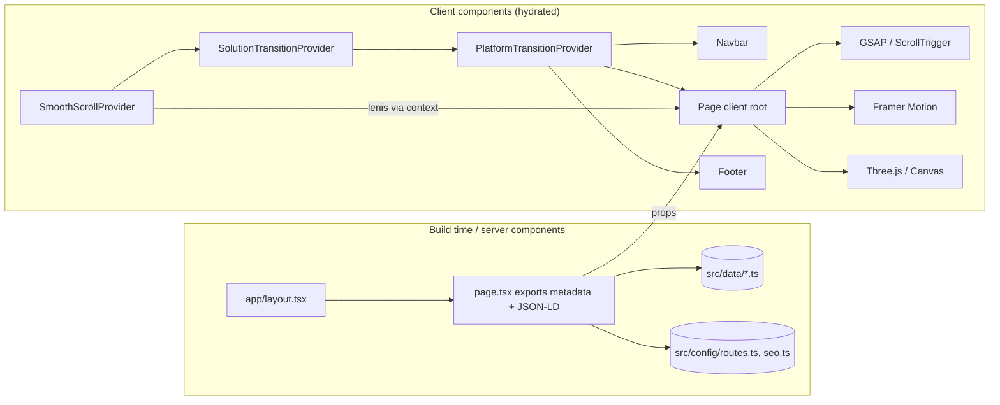
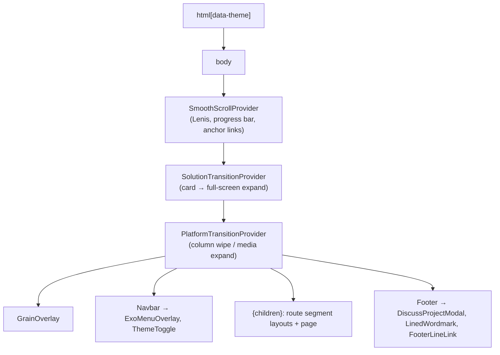
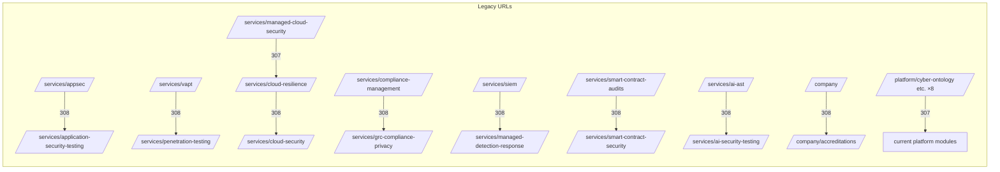
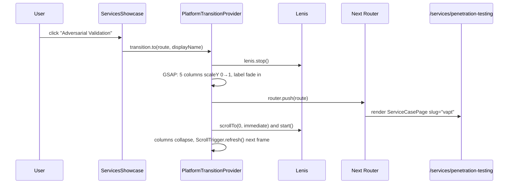

# Project Architecture

How the Entersoft website is put together: rendering model, provider tree, routing, templates, data flow, and a folder-by-folder guide.

Related: [TECH_STACK.md](TECH_STACK.md) · [PAGES_AND_FEATURES.md](PAGES_AND_FEATURES.md) · [ANIMATIONS_AND_INTERACTIONS.md](ANIMATIONS_AND_INTERACTIONS.md)

---

## 1. Architectural summary

The site is a **statically generated marketing application** on the Next.js App Router. Its architecture comes down to six decisions:

1. **Thin server pages, rich client components.** Every `page.tsx` is a server component that exports `metadata` (and sometimes JSON-LD) and renders one large `"use client"` component. That component owns state, DOM measurement and animation.
2. **Content lives in typed data modules.** `src/data/*.ts` holds the copy, images and structure. The same templates render many routes from different data objects.
3. **One global scroll engine.** `SmoothScrollProvider` creates a single Lenis instance driven by `gsap.ticker`. It calls `ScrollTrigger.update()` on every scroll, and every animated component builds on that clock.
4. **Global transition providers.** Two React contexts, `PlatformTransitionProvider` and `SolutionTransitionProvider`, run cross-page transitions. They intercept navigation, animate an overlay, call `router.push`, and reveal the next page.
5. **Theme as a DOM attribute.** `data-theme` on `<html>` (`light` or `dark`) is set before hydration. Most theming is done in CSS through tokens and attribute selectors.
6. **No backend.** There are no API routes, server actions, middleware or database. Every route can be pre-rendered. The last successful production build generated 82 static pages (recorded in the Cursor chat "Fix build error", 28 Oct 2026).



## 2. Rendering model

| Concern | How it is done | Evidence |
|---|---|---|
| Static generation | No dynamic data. The four `[slug]` routes use `generateStaticParams` with `dynamicParams = false`, so unknown slugs return 404. | `src/app/solutions/[slug]/page.tsx`, `industries/[slug]`, `company/[slug]`, `resources/[slug]` |
| Server components | Root layout, most `page.tsx` files, `vapt/layout.tsx` | `src/app/layout.tsx` |
| Client components | Every animated section, template and navigation component, plus the section layouts for platform, services and solutions (they need `usePathname`) | `"use client"` at the top of each file |
| Metadata | Static `export const metadata`, or `generateMetadata` for `[slug]` routes | See [SEO_SECURITY_AND_DEPLOYMENT.md](SEO_SECURITY_AND_DEPLOYMENT.md) |
| Dynamic imports | Used only in legacy pages (`AppSecPlatformPage` → `RubiksCube3D` with `ssr:false`; `AZ0_Hero` → `AIGraphScene`). The homepage uses only static imports. | — |
| Streaming, loading and error UI | **None.** There are no `loading.tsx`, `error.tsx` or `not-found.tsx` files, so Next.js defaults apply. | — |

## 3. Root layout and provider tree

`src/app/layout.tsx` (server component) does the following:
- **Fonts:** loads Inter Tight, Inter and IBM Plex Mono through `next/font/google` as CSS variables, plus several Google Fonts `<link>` stylesheets.
- **Metadata:** declares the root `metadata` (title, description, `metadataBase`, OpenGraph, Twitter) and a `robots` value. `robots` is `noindex` on any non-production host, via `IS_PRODUCTION_HOST`.
- **Viewport:** declares the viewport (`viewportFit: "cover"`).
- **Theme:** renders `<html data-theme="light" suppressHydrationWarning>` and a `beforeInteractive` script that applies `localStorage.theme`.
- **Providers:** wraps the page in the client providers below.



Why this order:
- Lenis sits outermost, so both transition providers can `stop()`/`start()` it and scroll to the top during navigation.
- The transition overlays are portals or fixed elements, so they cover the Navbar, the page and the Footer.

### Section layouts

| File | Type | Responsibility |
|---|---|---|
| `src/app/platform/layout.tsx` | client | Picks the theme by path (the hub is light, modules are dark), sets a `data-page` wrapper (`enprobe`, `platform-ova`, `dast`, `api`, ...), and forces `overflow-x: clip` for pinned pages. On unmount it removes `data-theme` rather than restoring the saved theme. |
| `src/app/services/layout.tsx` | client | For the 7 current service paths and `/services`, it forces the dark theme and adds a per-service background colour (`data-page="solution-case"`). Other service paths get an "Explore Services" cross-navigation bar. |
| `src/app/services/vapt/layout.tsx` | server | Metadata only. It exists because the legacy `vapt/page.tsx` is a client component. |
| `src/app/solutions/layout.tsx` | client | For the 6 solution pages, it forces the light theme and sets a per-page `data-page` attribute and background colour. |

## 4. Routing architecture

- **File-system routes** live under `src/app`: 56 `page.tsx` files and 5 layouts.
- **Central URL registry:** `src/config/routes.ts` exports:
  - `PRODUCTION_URL` and `METADATA_BASE`
  - `IS_PRODUCTION_HOST`
  - `SERVICE_SLUGS`
  - `ROUTES` (every internal URL, including legacy alias targets)
  - `getServiceKeyFromSlug`, `getServiceRoute`, `getCanonicalUrl`

  Navigation, sitemap and canonicals are all supposed to use it.
- **Redirects:**
  - **Permanent (308):** `next.config.ts` redirects 7 legacy service URLs and `/company`.
  - **Temporary (307):** 8 legacy platform URLs and `/services/managed-cloud-security` call `redirect()` from `next/navigation` inside `page.tsx`.



Next.js applies `next.config.ts` redirects **before** filesystem routing, so the legacy `page.tsx` files under those seven service URLs can never render. They are documented as **legacy** throughout. The complete route table is in [PAGES_AND_FEATURES.md](PAGES_AND_FEATURES.md).

## 5. Template architecture (data → template → route)

| Template | File | Data | Routes |
|---|---|---|---|
| Service case page | `src/components/services/ServiceCasePage.tsx` | `src/data/serviceCases.ts` (visuals) + `serviceCaseCopy.ts` (copy assembled from `services.ts`, `cloudResilience.ts`, `digitalTrust.ts`, `cyberDefense.ts`, `aiZkpass.ts`) | 7 current service pages |
| Services reel hub | `src/components/services/ServicesReel.tsx` | `SERVICE_CASES`, `SERVICE_CASE_ORDER` | `/services` |
| Cloud offering | `src/components/services/cloud-resilience/CloudOfferingLayout.tsx` | `cloudOfferings` in `cloudResilience.ts` | 5 `/services/cloud-resilience/*` pages |
| Platform OVA | `src/components/platform/ova/PlatformOvaPage.tsx` | `SAST_OVA`, `SCA_OVA`, `SBOM_OVA`, `SECRETS_OVA`, `IAC_OVA` (`platformOva.ts`) | sast, sca, sbom-license-risk, secrets, iac |
| EnProbe OVA | `src/components/platform/enprobe/EnprobeOvaPage.tsx` | `enprobeOva.ts` | `/platform/enprobe` |
| ExoApe case study | `src/components/platform/exoape/ExoApeCaseStudy.tsx` + `types.ts` | `dastCase`, `agenticCase`, `apiCase`, `asmCase`, `cloudCase`, `aiCase` | dast, agentic-pentesting, api-security, attack-surface-management, cloud-appsec, ai-appsec |
| Platform subpage | `src/components/platform/PlatformSubpageTemplate.tsx` | `platformPillars` (`platform.ts`) | container, compliance-reporting, threat-intelligence |
| Platform hub | `src/components/platform/PlatformHubScene.tsx` | `PLATFORM_HUB_ITEMS` (`platformHub.ts`) | `/platform` |
| Solutions gallery | `src/components/solutions/SolutionsWorksGallery.tsx` | `SOLUTION_LANDINGS` | `/solutions` |
| Solution pages | 6 bespoke components in `src/components/solutions/*/` | `SOLUTION_LANDING_BY_SLUG` | `/solutions/[slug]` |
| Editorial page | `src/components/site/EditorialPage.tsx` | `EditorialDoc` blocks (`editorial.ts`) from `companyPages.ts`, `industries.ts`, inline `resourceDocs` | company, industries, resources `[slug]` |

**How a route resolves to a component.** The solutions route is the most explicit example. It validates the slug with a type guard, fetches the data object, and branches to a bespoke component:

```48:70:src/app/solutions/[slug]/page.tsx
export default async function SolutionLandingRoute({ params }: PageProps) {
  const { slug } = await params;
  if (!isSolutionLandingSlug(slug)) notFound();
  const page = SOLUTION_LANDING_BY_SLUG[slug];
  if (slug === "api-discovery") {
    return <ApiDiscoveryPortalPage page={page} />;
  }
  // ... five more bespoke branches ...
  return <SolutionLandingPage page={page} />;
}
```

In Next 16, `params` is a **Promise** and must be awaited. This is one of the breaking changes `AGENTS.md` warns agents about.

## 6. State management and component communication

There is no global state library. State is handled with four patterns:

| Pattern | Where | Purpose |
|---|---|---|
| Local `useState` / `useRef` | Every interactive section | Active index, hover, open/closed state. `useRef` holds DOM nodes and mutable animation values, so they don't trigger re-renders. |
| React context | `SmoothScrollProvider` (`useSmoothScroll()` → Lenis), `PlatformTransitionProvider` (`usePlatformTransition().to(href,label,expand?)`), `SolutionTransitionContext` (`startFromCard`, `notifyExpanded`, `markArrived`) | Cross-tree services |
| DOM attribute as shared state | `data-theme` on `<html>`, read by CSS, by `Navbar` (MutationObserver) and by `TrackRecord3DCylinder` (MutationObserver) | Theme |
| Browser events | `window` `CustomEvent("themeChange")` from `ThemeToggle`; Lenis `scroll` events | Decoupled notifications |
| CSS custom properties written from JS | `--lg-y` (LandingGradient), and inline transforms written by GSAP | High-frequency values that would be wasteful in React state |

A consistent performance rule: **values that change every frame never go through React state.** They are written straight to the DOM with `gsap.set`, `style.transform` or `style.setProperty`. React state changes only on discrete events, such as the active card index changing in the cylinder.

## 7. Hooks and utilities

| File | Export | Used by | Status |
|---|---|---|---|
| `src/hooks/useReducedMotion.ts` | `useReducedMotion()`: a `matchMedia` wrapper with a change listener and Safari fallback | ~100 files | Implemented. The first render always returns `false`. |
| `src/hooks/useStripeWipe.ts` | `useStripeWipe(rootRef, stripesRef, sheetRef, reduce, opts)` | Testimonials, CertificationsMarquee | Implemented |
| `src/hooks/useMagnetic.ts` | `useMagnetic(strength, radius)` | `MagneticButton` | Implemented |
| `src/hooks/useCursor.ts` | `useCursor()` | — | Legacy (unused) |
| `src/hooks/useScrollReveal.ts` | `useScrollReveal()` | — | Legacy (unused) |
| `src/lib/utils.ts` | `cn()` = `twMerge(clsx(...))`, `formatNumber()` | ~13 files | Implemented |
| `src/lib/animations.ts` | `EASE`, `DURATION`, `STAGGER`, `PALANTIR_EASE`, Framer variants | 2 files (only `fadeInUpVariants`) | Mostly unused tokens |
| `src/lib/scrollTriggerHelpers.ts` | `isTouchDevice()`, `createDesktopOnlyTrigger()` | `stackTransition.ts` only | Legacy |
| `src/lib/stackTransition.ts` | `createStackTransition()` | orphan `CloudPageRoot` | Legacy |
| `src/lib/performanceTier.ts` | `getPerformanceTier()` | — | Legacy (unused) |

## 8. Configuration files

| File | Purpose |
|---|---|
| `package.json` | Scripts (`dev`/`build` with `--webpack`), dependencies |
| `next.config.ts` | `allowedDevOrigins: ['*.trycloudflare.com']` (dev access through Cloudflare quick tunnels), `images.qualities [75,85,95]`, `images.remotePatterns` (CloudFront, Unsplash), 8 permanent redirects |
| `tsconfig.json` | `strict`, `moduleResolution: bundler`, `jsx: react-jsx`, path alias `@/* → ./src/*`, Next plugin |
| `eslint.config.mjs` | Flat config from `eslint-config-next` (core-web-vitals + typescript) with 11 rules disabled |
| `postcss.config.mjs` | Only `@tailwindcss/postcss`. There is no `tailwind.config.*`; Tailwind 4 is configured in CSS via `@theme`. |
| `src/styles/tokens.css` | Design tokens for light and dark |
| `src/app/globals.css` | Tailwind import, `@theme`, global rules, and section- and theme-specific overrides (about 3,630 lines) |
| `.env.example` | `NEXT_PUBLIC_APP_URL` (names only, no secrets) |
| `AGENTS.md` | Instruction to AI agents: Next 16 has breaking changes, so read `node_modules/next/dist/docs/` first |

## 9. Folder-by-folder guide

```text
src/
├── app/                       Routes (App Router)
│   ├── layout.tsx             Root: metadata, fonts, theme script, providers, Navbar/Footer
│   ├── page.tsx               Homepage: JSON-LD + 8 sections
│   ├── globals.css            Tailwind 4 + global & section CSS
│   ├── sitemap.ts, robots.ts  SEO routes
│   ├── services/              Hub, 7 current pages, cloud-resilience/*, 7 legacy pages
│   ├── platform/              Hub, enprobe, 15 modules, 8 alias redirects, api-security.css
│   ├── solutions/             Hub + [slug]
│   ├── company/               accreditations + [slug]
│   ├── industries/[slug], resources/[slug], contact, booking
├── components/
│   ├── layout/                Site chrome, providers and transitions
│   ├── sections/              Homepage sections
│   ├── ui/                    Small reusable primitives
│   ├── services/              Service templates + legacy bespoke service experiences
│   ├── platform/              Platform templates, module data, legacy families
│   ├── solutions/             Solutions gallery, transitions, bespoke pages + CSS
│   └── site/                  EditorialPage
├── config/                    routes.ts, seo.ts
├── data/                      Typed content modules (31 files)
├── hooks/                     5 hooks
├── lib/                       5 helpers
└── styles/                    tokens.css
```

### `src/app`
- **Purpose:** URL structure, metadata and SEO routes.
- **Entry points:** `layout.tsx` and `page.tsx`.
- **Pattern:** most route files are 10–70 lines. They set metadata and JSON-LD, then render a component.
- **Exceptions:** `services/vapt/page.tsx` (~900 lines, legacy client page with an inline Three.js scene), `services/appsec/page.tsx` (legacy), `company/accreditations/page.tsx` (inline JSX) and `resources/[slug]/page.tsx` (holds the `resourceDocs` content map inline).

### `src/components/layout`
- **Purpose:** site chrome shared by every page.
- **Key files:**

| File | Responsibility | Key exports / dependencies |
|---|---|---|
| `SmoothScrollProvider.tsx` | Lenis instance, GSAP ticker integration, ScrollTrigger sync, hash-link scrolling, 2px progress bar | `default`, `useSmoothScroll`; lenis, gsap |
| `PlatformPageTransition.tsx` (+ `.css`) | Intercepts clicks on `/platform/*` and `/services/*` links and runs a 5-column wipe or a media expand | `PlatformTransitionProvider`, `usePlatformTransition`; gsap, next/navigation, `platformHub.ts` |
| `Navbar.tsx` | Fixed header with three variants (transparent over the hero, glass pill once scrolled, per-route themes), mega menus, menu button, theme toggle, CTA | `navItems` built from `ROUTES` and `*Nav` data |
| `ExoMenuOverlay.tsx` | Full-screen menu dialog with a grid-cell wipe and flyouts | `role="dialog"`, Escape to close, scroll lock |
| `Footer.tsx` | Scroll-revealed footer sheet, link directory, IST clock, `LinedWordmark`, Discuss modal trigger | gsap ScrollTrigger |
| `DiscussProjectModal.tsx` | Bottom-sheet form with a focus trap. Submission is **simulated**. | portal, gsap, Lenis stop |
| `LinedWordmark.tsx` | Canvas "ENTERSOFT" wordmark drawn as line runs that ripple near the pointer | canvas 2D, rAF |
| `FooterLineLink.tsx` | Link whose SVG underline bends toward the pointer | rAF, quadratic curve |
| `GrainOverlay.tsx` | Static SVG `feTurbulence` film grain | — |
| `LightFooter.tsx`, `FluidPreloader.tsx`, `CustomCursor.tsx` | — | Legacy or unused |

### `src/components/sections`
Homepage sections, in render order:
1. `Hero` (+ `HeroCursor`)
2. `StatsCounter` → `TrackRecord3DCylinder`
3. `ServicesShowcase`
4. `Differentiators`
5. `Testimonials`
6. `DesignInMotion`
7. `InsightsBlog`
8. `CertificationsMarquee`

`FinalCTA` is used only on `/contact`. `ValueProposition` and `CaseStudies` are unused. Per-section details are in [PAGES_AND_FEATURES.md](PAGES_AND_FEATURES.md#2-homepage) and [ANIMATIONS_AND_INTERACTIONS.md](ANIMATIONS_AND_INTERACTIONS.md).

### `src/components/ui`
Primitives:

| Component | Status |
|---|---|
| `Button` | Used in 25 files |
| `MagneticButton` | Used in 15 files |
| `SectionLabel` | Used in 25 files |
| `AnimatedDivider` | Used |
| `LandingGradient` | Used in 7 homepage sections |
| `StripeWipeBars` | Used |
| `ThemeToggle` | Used |
| `AnimatedCounter`, `CapabilityCard`, `ServiceHoverCard`, `BackgroundRippleEffect`, `RevealText` | Unused or legacy |

### `src/components/services`
- **Live:** `ServiceCasePage`, `ServicesReel`, `cloud-resilience/*`.
- **Legacy** (only on redirected routes, or nothing imports them):
  - `AppSecPlatformPage`
  - `VAPTHero`
  - `compliance-v2/`
  - `cyber-defense/`
  - `smart-contract-v2/`
  - `ai-zkpass/`
  - `ai-systems/`, `ai-systems-v2/`, `ai-systems-v3/`
  - `cloud/`, `cloud-v2/`
  - `visuals/`
  - `RubiksCube3D`
  - `ServiceHero`, `ServiceProcess`, `ServiceCTA`, `ServiceFAQ`, `ServiceDeliverables`, `ServiceBreadcrumb`, `ServiceCaseHero`
  - `SIEMProofBand`

These folders hold most of the project's experimental WebGL, canvas, anime.js and d3 work. See [DEVELOPMENT_HISTORY.md](DEVELOPMENT_HISTORY.md) for how they came about.

### `src/components/platform`
- **Live:**
  - Templates: `ova/`, `exoape/`, `enprobe/`
  - Hub: `PlatformHubScene`, `platform-hub.css`
  - `PlatformSubpageTemplate`, `HubClip`, `HubArrivePhoto`
  - Per-module data: `*Case.ts`
  - `roots/ExposureDecisioningRoot`, `visuals/AttackPathVisualizer`
  - Thin wrappers: `DastExoapePage`, `AgenticPentestingExoapePage`, `api/ApiPageRoot`, `asm/AsmPageRoot`
- **Legacy:**
  - the other 11 `roots/*`
  - `sast/`, `sca/`, `sbom/`, `iac/Iac_*`
  - `secrets/` (three duplicate families: `NovaSecrets_*`, `Secrets_*`, `ThayonSecrets_*`)
  - `api/Api*` sections, `asm/Asm*` sections
  - `common/PlatformFAQ`, `dast/ExoMotion` (duplicate)
  - most of `visuals/`
  - `enprobeCase.ts`, `iacCase.ts`

### `src/components/solutions`
- **Live:**
  - `SolutionsWorksGallery` (+ `solutions-works.css`)
  - `SolutionTransitionContext`, `SolutionExpandOverlay`, `SolutionArrivalMarker`
  - six bespoke pages, each with its own CSS: `api-discovery/`, `ai-bom/AiBomKryntPage`, `manage-vuln/`, `automate-workflows/`, `track-kpis/`, `open-source/`
  - `solution-case.css`, which is also used by the service case pages
- **Legacy:** `SolutionLandingPage`, `SolutionDemoForm`, `SolutionCasePage`, `SolutionsShowcase`, `AiBomIncreasePage`, `solution-landing.css`, `solutions-work.css`.

### `src/components/site`
`EditorialPage.tsx` renders `EditorialDoc` blocks: `stats`, `panels`, `steps`, `split`, `people`, `quote`, `prose`, `faq`, `index` and `cta`. It is used by all company, industry and resource pages.

### `src/data`

| File | Feeds | Status |
|---|---|---|
| `services.ts` | `services[]` (7 services with plain and branded names), `servicePagesData` | Live |
| `serviceCases.ts`, `serviceCaseCopy.ts` | Service template | Live |
| `cloudResilience.ts`, `digitalTrust.ts`, `cyberDefense.ts`, `aiZkpass.ts` | Copy for the service template and cloud sub-pages | Live, through `serviceCaseCopy.ts` |
| `platform.ts`, `platformHub.ts` | Platform pillars, hub items | Live |
| `solutionLandings.ts` | Solutions | Live |
| `companyPages.ts`, `industries.ts`, `resources.ts`, `editorial.ts`, `editorialImages.ts` | Editorial pages, nav lists | Live |
| `differentiators.ts`, `testimonials.ts`, `blog.ts`, `certifications.ts` | Homepage sections | Live |
| `sast.ts` | Demo code strings | Partially live |
| `stats.ts`, `caseStudies.ts`, `aiSystems*.ts`, `cloudSecurity.ts`, `cloudV2.ts`, `solutionCases.ts` | — | Legacy (consumers are unused) |

### `public/`
- `images/`: 311 files in total.

  | Folder | Files |
  |---|---|
  | `platform/` | 153 (`runtime`, `ova`, `hub`, `enprobe-ova`) |
  | `solutions/` | 122 |
  | `track-record/` | 10 |
  | `outcomes/` | 7 |
  | `menu/` | 4 |
  | `secrets/` | 4 |
  | `enprobe/` | 2 |
  | `hero/` | 1 (`poster.jpg`, unused) |
  | Loose PNGs | 7 |

- `videos/`: 22 MP4s (16 platform hub clips, solution heroes, and an unused `hero-background-optimized.mp4`).
- The homepage hero video is served from an external S3 bucket, not from `public/`.

## 10. Data flow example: homepage service click



## 11. Architectural risks and known issues (summary)

See [KNOWN_ISSUES_AND_FUTURE_WORK.md](KNOWN_ISSUES_AND_FUTURE_WORK.md) for details.

- **Large amount of unreachable code.** A large share of `src/components` is legacy. It increases maintenance cost and confuses repository searches.
- **`globals.css` is very large** (about 3,630 lines). It holds many `!important` section overrides, and its size is what made Turbopack time out.
- **`ROUTES.services.cloudResilience.*` points to URLs that return 404.** It builds `/services/cloud-security/<sub>`, but the real pages are at `/services/cloud-resilience/<sub>`.
- **The platform layout clears the saved theme on unmount.** It removes `data-theme` instead of restoring the value from `localStorage`.
