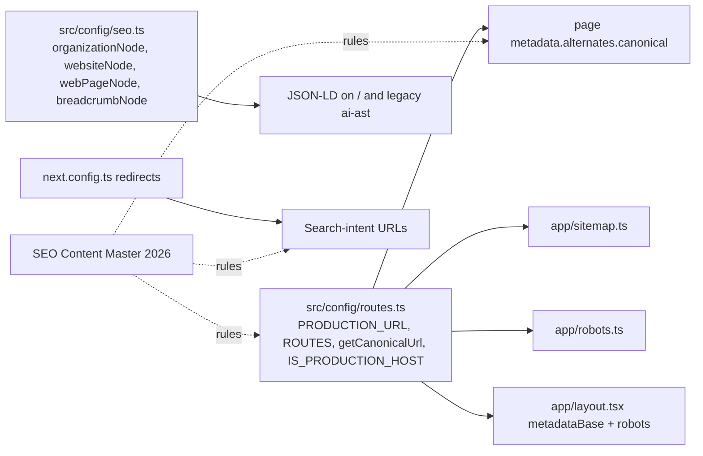

# SEO, Security and Deployment

This document covers what the SEO, security and production-readiness implementation does today. Each section ends with recommended improvements, kept separate from what is already in place.

Related: [PAGES_AND_FEATURES.md](PAGES_AND_FEATURES.md) · [KNOWN_ISSUES_AND_FUTURE_WORK.md](KNOWN_ISSUES_AND_FUTURE_WORK.md)

---

## 1. SEO architecture



### 1.1 Host strategy (`src/config/routes.ts`)

| Constant | Value / logic | Purpose |
|---|---|---|
| `PRODUCTION_URL` / `APP_URL` | `https://www.entersoftsecurity.com`, hard-coded | One canonical host for every canonical, sitemap URL and JSON-LD `@id` |
| `METADATA_BASE` | `NEXT_PUBLIC_APP_URL` or `PRODUCTION_URL`, with any trailing slash removed | Resolves relative OG and asset URLs against the host actually serving the page |
| `IS_PRODUCTION_HOST` | `true` if the `METADATA_BASE` hostname is `www.entersoftsecurity.com` or `entersoftsecurity.com` | On any other host, the root `metadata.robots` is `{ index:false, follow:false }` and `robots.txt` returns `disallow: /` |

**Caveat:** `NEXT_PUBLIC_*` values are inlined at build time. A preview build made **without** `NEXT_PUBLIC_APP_URL` falls back to the production URL and is therefore indexable. Always set the variable in preview and staging environments.

### 1.2 Metadata

**Root (`src/app/layout.tsx`):**
- Default title: "Application Security & Penetration Testing | Entersoft". There is no `title.template`.
- Description, `applicationName`, OpenGraph (`siteName`, `en_US`, `website`) and Twitter `summary_large_image`.
- `viewportFit: cover`.
- **No default OG image.** There is no `opengraph-image` file.

**Per page:** a static `metadata` export, or `generateMetadata` for `[slug]` routes. The service pages show the pattern:

```11:30:src/app/services/penetration-testing/page.tsx
export const metadata: Metadata = {
  title: TITLE,
  description: DESCRIPTION,
  alternates: {
    canonical: CANONICAL,
  },
  openGraph: {
    title: TITLE,
    description: DESCRIPTION,
    url: CANONICAL,
    siteName: "Entersoft Security",
    locale: "en_US",
    type: "website",
  },
  twitter: {
    card: "summary_large_image",
    title: TITLE,
    description: DESCRIPTION,
  },
};
```

**Title convention:** the plain search term first, then a qualifier, then the brand. For example, "Penetration Testing Services | CREST-Accredited | Entersoft".

### 1.3 Canonical coverage

| Group | Canonical |
|---|---|
| Homepage, `/services`, 7 service pages, 5 cloud sub-pages, `/solutions` + 6, editorial `[slug]` pages, accreditations, contact, booking | ✅ self |
| `/platform/enprobe`, api-security, attack-surface-management, cloud-appsec, ai-appsec | ✅ self |
| `/platform` hub, sast, sca, sbom-license-risk, secrets, iac, dast, agentic-pentesting, aspm, container, compliance-reporting, threat-intelligence | ❌ **missing** (12 pages) |

### 1.4 Structured data (JSON-LD)

| Page | Types |
|---|---|
| `/` | Organization, WebSite and WebPage from `seo.ts`, injected via `next/script id="home-jsonld"` |
| Current service pages | BreadcrumbList, plus FAQPage on application-security-testing. The URLs are hard-coded strings. |
| Cloud sub-pages | Organization, WebPage, Service, BreadcrumbList |
| `/platform/enprobe` | SoftwareApplication |
| `/company/accreditations` | Organization with `hasCredential` (CREST, CERT-In) |
| Legacy service pages | Fuller Service/FAQ graphs, but these pages never render |

**Recommendations:**
- Confirm the homepage JSON-LD appears in the server HTML. It is injected through `next/script` rather than a plain `<script type="application/ld+json">`.
- Move the richer Service schema onto the current service pages.
- Build the breadcrumbs with `breadcrumbNode` instead of hard-coded strings.

### 1.5 Redirects and URL conventions

- **Convention:** URLs are lowercase, hyphenated, search-intent slugs (`/services/penetration-testing`, `/platform/sbom-license-risk`).
- **308 permanent redirects** in `next.config.ts`:
  - `/services/appsec` → `/services/application-security-testing`
  - `/services/vapt` → `/services/penetration-testing`
  - `/services/cloud-resilience` → `/services/cloud-security` (exact path only)
  - `/services/compliance-management` → `/services/grc-compliance-privacy`
  - `/services/siem` → `/services/managed-detection-response`
  - `/services/smart-contract-audits` → `/services/smart-contract-security`
  - `/services/ai-ast` → `/services/ai-security-testing`
  - `/company` → `/company/accreditations`
- **307 temporary redirects** from `redirect()` in page files:
  - 8 platform aliases
  - `/services/managed-cloud-security`, which causes a two-hop chain
- **Recommendation:** move these into `next.config.ts` with `permanent: true`.

### 1.6 Sitemap and robots

The sitemap is generated by `src/app/sitemap.ts`. Every entry's `lastModified` is the build time (`new Date()`).

| Group | Priority | Entries |
|---|---|---|
| `/` | 1.0 | 1 |
| `/services` | 0.95 | 1 |
| `/solutions` | 0.9 | 1 |
| Solution pages | 0.85 | 6 |
| Service pages | 0.9 | 7 |
| Platform modules | 0.8 | 15 |
| Cloud sub-pages | 0.7 | 5 (these URLs **404**: they are `/services/cloud-security/*`) |
| Resources | 0.6 | 6 |
| Industries | 0.7 | 6 |
| Company pages + `/contact` | 0.6 | 9 |
| Accreditations | 0.6 | 1 |

Gaps:
- Missing: `/platform`, `/platform/enprobe`, and the real `/services/cloud-resilience/*` URLs.
- `/booking` is correctly excluded.

`src/app/robots.ts`:
- Production: `allow: /`, plus `sitemap` and `host`.
- Other hosts: `disallow: /`.

### 1.7 On-page SEO

- **Headings:**
  - The SEO master requires one H1 per page. The homepage currently has two (Hero, TrackRecord).
  - "Work in / Motion" is split across two H2s.
- **Alt text:**
  - Content images have descriptive alt text.
  - Decorative images use `alt=""`.
  - Credential logos are labelled.
- **Internal linking:**
  - Navbar, overlay and footer link to every current route.
  - Platform "where it fits" grids link to services, via legacy slugs that redirect.
  - Service pages cross-link to related services.
- **Crawlable text:** the homepage services and briefs render real text in the DOM, not canvas. The mobile insights list is a separate DOM list.

## 2. Security posture

This website is a static, unauthenticated marketing site with no server-side data handling. That keeps the attack surface small. The relevant controls are listed below.

| Area | Status | Detail |
|---|---|---|
| Authentication / authorization / RBAC | Not applicable | No user accounts or protected areas |
| API security | Not applicable | No API routes, server actions or middleware |
| Secrets in source | ✅ None found | The only env var read is `NEXT_PUBLIC_APP_URL`, which is public by design. Names like `AWS_SECRET_ACCESS_KEY` and `JWT_SECRET` appear only as **fake strings inside demo code** on product pages. |
| `.env*` handling | ✅ | `.gitignore` excludes every `.env*` variant. `.env.example` lists names only. |
| Input validation / sanitisation | Partial | Client-side only (`required`, `type=email`, `minLength`). Safe for now because nothing is submitted. Must be added on the server before forms send data. |
| XSS | Low risk | React escapes output. `dangerouslySetInnerHTML` is used for JSON-LD with `JSON.stringify` of static objects. One legacy component (`CursorImageTrail`) writes `innerHTML` from static labels. |
| Security headers | ❌ Not configured | No `headers()` in `next.config.ts` and no middleware: no CSP, HSTS, X-Frame-Options/`frame-ancestors`, Referrer-Policy, Permissions-Policy or X-Content-Type-Options. `poweredByHeader` is not disabled. |
| Third-party resources | Present | Google Fonts CSS, a CloudFront logo, Unsplash images, an S3 hero video, a Google Calendar link, and social links (`target="_blank"`; verify `rel="noopener noreferrer"` everywhere). No analytics or tag scripts. |
| Dependency vulnerabilities | **Unverified** | `npm audit` has not been run as part of this documentation. Unused packages (`@splinetool/react-spline`, `animejs`, `d3-force`, `@types/animejs`) increase the dependency surface for no benefit. |
| Repository hygiene | ❌ **Issue** | Commit `1f0c3bf` added `.tmp-nav-shots/` with two Microsoft Edge browser profiles (1,820 files) to the GitHub repository. Browser profiles can contain cookies, session tokens and history. The contents were not inspected. **Treat this as a potential credential exposure** (see the known-issues document). |
| Dev server exposure | Configured | `allowedDevOrigins: ['*.trycloudflare.com']` lets Cloudflare quick tunnels reach the dev server. Share tunnel URLs only with intended reviewers. |
| Security claims in content | Needs review | Credential wording ("GDPR Compliant", "CERT-In Accredited") is covered in [CYBERSECURITY_DOMAIN.md](CYBERSECURITY_DOMAIN.md#3-standards-and-frameworks-referenced) |

For a security company's own website, a missing CSP and missing headers are also a credibility issue.

### Recommended security headers

A starting point. Tighten `script-src` and `style-src` once inline scripts are reviewed: `next/script` `beforeInteractive` and inline JSON-LD need nonces or hashes.

```ts
// next.config.ts (proposal, not implemented)
async headers() {
  return [{
    source: "/(.*)",
    headers: [
      { key: "Strict-Transport-Security", value: "max-age=63072000; includeSubDomains; preload" },
      { key: "X-Content-Type-Options", value: "nosniff" },
      { key: "Referrer-Policy", value: "strict-origin-when-cross-origin" },
      { key: "Permissions-Policy", value: "camera=(), microphone=(), geolocation=()" },
      { key: "Content-Security-Policy", value:
        "default-src 'self'; img-src 'self' data: https://d2ghx8biuioax8.cloudfront.net https://images.unsplash.com; " +
        "media-src 'self' https://new-entersoft-website2026.s3.ap-south-1.amazonaws.com; " +
        "style-src 'self' 'unsafe-inline' https://fonts.googleapis.com; font-src 'self' https://fonts.gstatic.com; " +
        "script-src 'self' 'unsafe-inline'; frame-ancestors 'none'" },
    ],
  }];
},
poweredByHeader: false,
```

## 3. Production readiness

| Check | Status |
|---|---|
| Type checking | ✅ `npx tsc --noEmit` passes (31 Oct 2026) |
| Linting | ⚠️ 3 errors and 11 warnings (React Compiler rules and unused disable comments; see [TESTING_AND_DEBUGGING.md](TESTING_AND_DEBUGGING.md#2-current-check-results)). 11 rules are disabled in config. |
| Production build | ✅ With `next build --webpack`: the last recorded run passed and generated 82 static pages (28 Oct). Turbopack builds time out. |
| Error pages | ❌ No `not-found.tsx`, `error.tsx` or `global-error.tsx`, so framework defaults are shown. The SEO master's release checklist requires a custom 404. |
| Loading states | Not applicable (static) |
| Forms / conversion | ❌ Contact and Discuss forms don't send data; `/booking` is a placeholder |
| Environment separation | ✅ noindex off-production (§1.1), provided `NEXT_PUBLIC_APP_URL` is set per environment |
| Logging and monitoring | ❌ None (no error tracking, no analytics, no Web Vitals reporting) |
| Accessibility | Partial (see [UI_UX_DESIGN_SYSTEM.md §7](UI_UX_DESIGN_SYSTEM.md#7-accessibility)) |
| Browser compatibility | Modern evergreen browsers assumed. A Safari `addListener` fallback exists for `matchMedia`; `100lvh` and `dvh` units need recent Safari and Chrome. No browser-test record. |

## 4. Deployment

- **Hosting platform: unverified.** The repository has no `vercel.json`, Dockerfile or CI workflow, and no deploy history. `.gitignore` lists `.vercel`, which suggests Vercel was considered.
- **Build and run:**

```powershell
npm ci
$env:NEXT_PUBLIC_APP_URL = "https://www.entersoftsecurity.com"   # set per environment
npm run build      # next build --webpack
npm run start      # next start (port 3000 by default)
```

- **Release checklist** (from the SEO master, condensed):
  - canonical URLs resolve and return 200;
  - staging is noindex;
  - the sitemap is submitted to Search Console;
  - custom 404;
  - OG tags and images;
  - alt text;
  - mobile parity;
  - reduced-motion support;
  - content readable without animation;
  - validated schema;
  - conversion events firing.

  Items marked ❌ above remain open.
