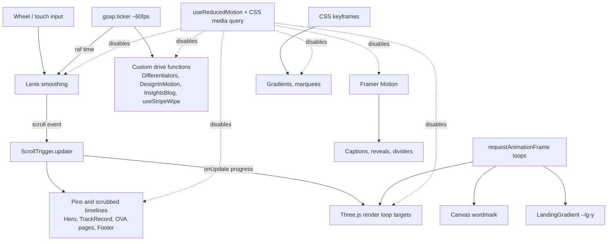

# Technology Stack

Every technology found in the repository, with what it is, why it is used, where and how it is integrated, and whether it is actually in use. Status is verified by tracing imports from `src/app/**/page.tsx`. An installed package does not count as "used" unless a live route reaches it.

Legend: **Implemented** (reached by a live route) · **Configured** (set up, little or no runtime use) · **Legacy** (only on redirected or unimported code) · **Unused** (installed, never imported) · **Not present**

Related: [PROJECT_ARCHITECTURE.md](PROJECT_ARCHITECTURE.md) · [ANIMATIONS_AND_INTERACTIONS.md](ANIMATIONS_AND_INTERACTIONS.md)

---

## 1. Version inventory (from `package-lock.json`)

| Package | Declared | Installed | Status |
|---|---|---|---|
| next | 16.2.9 | 16.2.9 | Implemented |
| react / react-dom | 19.2.4 | 19.2.4 | Implemented |
| typescript | ^5 | 5.9.3 | Implemented |
| tailwindcss / @tailwindcss/postcss | ^4 | 4.3.1 | Implemented |
| gsap | ^3.15.0 | 3.15.0 | Implemented (~50 files) |
| lenis | ^1.3.23 | 1.3.23 | Implemented (1 file) |
| framer-motion | ^12.40.0 | 12.40.0 | Implemented (~160 files) |
| three (+ @types/three) | ^0.185.0 | 0.185.0 | Implemented on 1 live component; 10 legacy scenes |
| lucide-react | ^1.20.0 | 1.20.0 | Implemented (icons) |
| clsx, tailwind-merge | ^2.1.1, ^3.6.0 | same | Implemented (`cn()`) |
| animejs | ^4.5.0 | 4.5.0 | Legacy (5 files, none live) |
| @types/animejs | ^3.1.13 | — | Stale: types for v3, while v4 ships its own types |
| d3-force (+ @types/d3-force) | ^3.0.0 | 3.0.0 | Legacy (1 orphan file) |
| @splinetool/react-spline | ^4.1.0 | 4.1.0 | **Unused**: never imported |
| eslint / eslint-config-next | ^9 / 16.2.9 | 9.39.4 / 16.2.9 | Configured |

Runtime used during development: Node v24.22.1 and npm 11.19.1 (nvm-windows). Next 16 requires Node ≥ 20.9 (`node_modules/next/package.json` `engines`).

---

## 2. Frontend technologies

### HTML5 and semantic markup — Implemented
- **What:** the document structure the browser renders.
- **Where:**
  - Sections use `<section id="...">`. Menus use `<nav aria-label>`, quotes use `<blockquote>`, and forms use `<form>`, `<label>` and `<input type="email" required>`.
  - The homepage section ids (`hero`, `track-record`, `services`, `capabilities`, `operational-validation`, `design-in-motion`, `insights`, `certifications`) double as **animation hooks**. For example, the footer animates `#certifications .ov-sheet`.
- **Gaps:**
  - The homepage renders two `<h1>` elements (Hero and the TrackRecord header).
  - There is no skip link.

### CSS3 — Implemented
- **What:** styling, layout, animation.
- **Where:**
  - `src/app/globals.css`: about 3,630 lines.
  - `src/styles/tokens.css`.
  - Page-scoped CSS imported by components: `solution-case.css`, `platform-ova.css`, `enprobe-ova.css`, `platform-hub.css`, `api-security.css`, `platform-page-transition.css`, and the six solution stylesheets.
- **Key concepts used:**
  - custom properties
  - `clamp()` fluid type
  - `@keyframes` (14 in `globals.css`, 44 in other files)
  - `repeating-linear-gradient`
  - `mix-blend-mode`
  - stacking contexts (`isolation`, `z-index:-1`)
  - `transform-style: preserve-3d` (card flip)
  - `prefers-reduced-motion`
  - `overflow-x: clip`
- **CSS Modules:** not present.
- **Scoped `<style jsx>`:** appears in a few legacy components, such as `ServiceHoverCard`.

### JavaScript (ES2017+) — Implemented
Used through TypeScript. The patterns you will see are:
- closures for the animation-loop state;
- `requestAnimationFrame`;
- `IntersectionObserver`, `ResizeObserver`, `MutationObserver`;
- `matchMedia`;
- `Array.prototype` mapping and filtering for content;
- `async`/`await` for route `params` and metadata.

### TypeScript — Implemented
- **Config:** `tsconfig.json` sets `strict: true`, `moduleResolution: bundler`, `jsx: react-jsx`, `noEmit`, and the path alias `@/* → ./src/*`.
- **Status:** `npx tsc --noEmit` passes (31 Oct 2026).
- **Typed content:**
  - The data types include `Service`, `ServiceCaseSlug`, `ExoApeCase`, `PlatformOvaPageData`, `SolutionLanding`, `EditorialDoc` and `PlatformPillar`.
  - Literal types come from `as const` objects (`ROUTES`, `SERVICE_SLUGS`).
  - Type guards such as `isSolutionLandingSlug(slug)` narrow slug strings to these literal types.
- **Relaxations:** `@typescript-eslint/no-explicit-any` is disabled. `useMagnetic` uses `useRef<any>`.

### React 19 — Implemented
- **What:** the component model.
- **How it's used:**
  - Function components and hooks: `useState`, `useRef`, `useEffect`, `useLayoutEffect`, `useMemo`, `useCallback`, `useContext`.
  - Utilities: `forwardRef` (`Button`), `cloneElement` (`MagneticButton`), `createPortal` (`DiscussProjectModal`, `HeroCursor`).
  - Context providers for Lenis and page transitions.
- **React Compiler lint rules:** `eslint-config-next` 16 includes the React Compiler rules (`react-hooks/immutability`, `react-hooks/purity`, `react-hooks/refs`). Three current lint errors come from them; see [TESTING_AND_DEBUGGING.md](TESTING_AND_DEBUGGING.md).

### Next.js 16 App Router — Implemented
- **Routing:** file-system routes in `src/app` and nested layouts. Four `[slug]` routes use `generateStaticParams`, `dynamicParams = false` and `notFound()`.
- **Metadata:** the `metadata` export and `generateMetadata`. Route params are a Promise (`await params`), which is new in Next 15/16.
- **Built-in modules:** `next/font/google`, `next/image`, `next/script` (`beforeInteractive` theme script and the homepage JSON-LD), `next/link`, and `next/navigation` (`useRouter`, `usePathname`, `redirect`, `notFound`).
- **Special files:** `sitemap.ts`, `robots.ts`.
- **Config:** `next.config.ts` with redirects, the image config and `allowedDevOrigins`.
- **Bundler:** Webpack via `--webpack`, for both `dev` and `build`. Turbopack is the Next 16 default, but it timed out on `globals.css` (commit `dc482ac`).
- **`AGENTS.md`** tells coding agents to read the bundled docs in `node_modules/next/dist/docs/` before writing Next code.

### Server vs client components — Implemented
- **Server components:** the root layout, most route files, and `vapt/layout.tsx`.
- **Client components:** every interactive or animated component (`"use client"`), plus the section layouts for platform, services and solutions, because they read `usePathname`.

### Tailwind CSS 4 — Implemented
- **Integration:** `postcss.config.mjs` loads `@tailwindcss/postcss`. `globals.css` starts with `@import "tailwindcss"` and a CSS-first `@theme` block. There is no JS config file.
- **Custom theme:**
  - Breakpoints: `xs 320`, `sm 375`, `md 768`, `lg 1024`, `xl 1280`, `2xl 1440`, `3xl 1920`. Note that `sm` is 375px, not Tailwind's default 640px.
  - Colours mapped to CSS variables.
  - `--animate-cell-ripple`.
- **Usage pattern:** utility classes, including arbitrary values such as `text-[clamp(2.75rem,5.94vw,5.344rem)]` and `md:-mt-[100vh]`, merged with `cn()`.
- **Dark mode:** `dark:` variants are **not wired** to `data-theme`, because there is no `@custom-variant`. Theming is done with tokens and `[data-theme=...]` selectors instead.

### PostCSS — Configured
Its only job is running the Tailwind 4 plugin.

### Accessibility — Partially implemented
See [UI_UX_DESIGN_SYSTEM.md §7](UI_UX_DESIGN_SYSTEM.md#7-accessibility).
- **In place:** reduced-motion support, `aria-*` on dialogs and icon buttons, a focus trap in `DiscussProjectModal`, and a global `:focus-visible` outline.
- **Gaps:**
  - no keyboard access to the desktop mega menus;
  - no skip link;
  - `ExoMenuOverlay` has no focus trap.

---

## 3. Animation and interaction technologies

A summary is below. The full engineering details are in [ANIMATIONS_AND_INTERACTIONS.md](ANIMATIONS_AND_INTERACTIONS.md).

| Technology | Status | Where (live) | Role |
|---|---|---|---|
| **GSAP 3** | Implemented | Hero, Differentiators, DesignInMotion, InsightsBlog, `useStripeWipe`, Footer, PlatformPageTransition, SolutionExpandOverlay, PlatformOvaPage, EnprobeOvaPage, ExoMotion, solution pages, `useMagnetic` | Timelines, `gsap.set` per-frame writes, `gsap.ticker` clock, `utils.clamp/interpolate`, `parseEase` |
| **ScrollTrigger** | Implemented | Same as GSAP | Pinning (Hero, TrackRecord, OVA pages), scrub, once-only reveals, refresh orchestration. It is the only GSAP plugin in use: no SplitText, Flip, Observer or `@gsap/react`. |
| **Lenis** | Implemented | `src/components/layout/SmoothScrollProvider.tsx` | Smooth mouse/trackpad scrolling at any width, driven by `gsap.ticker`; native on touch devices |
| **Framer Motion 12** | Implemented | ServicesShowcase captions, Hero scroll cue, AnimatedDivider, TrackRecord word reveal, many platform/solution sections | Declarative enter/exit (`AnimatePresence`), `whileInView`, `useInView`, `useMotionValue`/`useTransform`, `layoutId` tab indicators |
| **Three.js** | Implemented (1 live) | `src/components/sections/TrackRecord3DCylinder.tsx` | WebGL cylinder of glass cards, canvas textures, physical materials |
| **WebGL (raw)** | Not present | — | Only through Three.js |
| **GLSL shaders** | Legacy | `src/components/platform/iac/Iac_IridescenceBackground.tsx` (orphan) | The only `ShaderMaterial` in the repo |
| **Canvas 2D** | Implemented | `LinedWordmark` (footer), TrackRecord card textures | Procedural drawing, pointer ripple |
| **SVG animation** | Implemented | `FooterLineLink` (curve follows pointer), DesignInMotion dashed arcs, GrainOverlay `feTurbulence` | — |
| **CSS keyframes and transitions** | Implemented | Landing gradient, marquees, solution-case backgrounds (`sc-galactic`, `sc-prism`, ...), button sweeps, card flip | — |
| **IntersectionObserver** | Implemented | TrackRecord (pause rendering), Testimonials (autoplay only above 35% visibility) | Plus many legacy visuals |
| **requestAnimationFrame** | Implemented | TrackRecord, HeroCursor, LinedWordmark, FooterLineLink, LandingGradient, PlatformPageTransition, PlatformHubScene, ServicesReel, SolutionsWorksGallery | Custom loops |
| **Pointer tracking and custom cursor** | Implemented | `HeroCursor` (lerp follower over the hero) | `CustomCursor` and `useCursor` are legacy stubs |
| **Magnetic buttons** | Implemented | `useMagnetic` + `MagneticButton` | GSAP pull capped at 10px |
| **Page transitions** | Implemented | `PlatformPageTransition`, `SolutionTransitionContext` + `SolutionExpandOverlay` | — |
| **anime.js 4** | Legacy | `CloudTopologyMap`, `IAMTree`, `AnimeTelemetryVisual`, `AppSecPlatformPage`, `RubiksCube3D` | — |
| **d3-force** | Legacy | `services/cloud-v2/canvas/ForceGraph.tsx` | Force-directed network on canvas |
| **Spline** | Unused | — | Added in commit `30b083a` (VAPT page, July); no import remains |
| **Parallax** | Implemented (light) | TrackRecord mouse tilt, ExoApe collage, OpenSourceFlow hero scale | — |
| **Text reveal** | Implemented | InsightsBlog title lines (`yPercent` mask), ExoMotion `Reveal`, TrackRecord per-word colour | `RevealText` component is unused |

---

## 4. Backend and data technologies

| Item | Status | Notes |
|---|---|---|
| Node.js | Implemented, build/dev only | Next runs on Node. There is no custom server. |
| Next.js server features | Partially used | Server components and static generation only |
| API routes (`route.ts`) | **Not present** | — |
| Server Actions (`"use server"`) | **Not present** | — |
| Middleware / `proxy.ts` | **Not present** | — |
| REST or external APIs | **Not present** at runtime | The only network activity is `router.prefetch` and static assets (Google Fonts, CloudFront, Unsplash, S3 hero video) |
| Database | **Not present** | Content is in TypeScript modules |
| Authentication, authorization, RBAC, JWT | **Not present** | `JWT_SECRET` and similar names appear only inside demo code strings on security product pages |
| Server-side validation | **Not present** | Forms validate on the client only, then simulate a submit |
| Environment configuration | Implemented | `NEXT_PUBLIC_APP_URL` (`src/config/routes.ts`), `NODE_ENV` (prefetch only in production) |
| Data fetching and caching | Not applicable | Everything is static. Images use the `next/image` optimizer cache. |
| Analytics and tag manager | **Not present** | The SEO master lists a measurement plan; it is **planned** |

---

## 5. Development tools and workflow

| Tool | Evidence | Use |
|---|---|---|
| **Google Antigravity IDE** | `~/.gemini/antigravity-ide/brain`: 57 Entersoft conversation folders (18 Jun – 23 Sep 2026) with `implementation_plan.md`, `task.md` and `walkthrough.md` | Main AI coding agent for the first ~3 months. See [AI_ASSISTED_DEVELOPMENT.md](AI_ASSISTED_DEVELOPMENT.md). |
| **Cursor IDE** | Cursor agent transcripts (Jul – Oct 2026) | AI agent from July; the main tool from mid-October |
| **Git / GitHub** | `origin https://github.com/Yash-Bagul01/Entersoft.git`, single `main` branch, 74 commits | Version control |
| **npm** | `package-lock.json` (lockfile v3) | Packages and scripts |
| **TypeScript compiler** | `npx tsc --noEmit`; `.tmp-classify-unused.mjs` uses the TS compiler API to classify unused declarations | Type checks, dead-code audits |
| **ESLint 9** | `eslint.config.mjs` | Linting (11 rules disabled on 24 Aug 2026, commit `cdeff51`) |
| **Headless Chrome/Edge via the DevTools Protocol** | `.tmp-nav-shots/align.mjs`; temporary `_*.mjs` screenshot scripts used in Cursor sessions | Automated screenshots and layout measurement at set viewports and themes |
| **Cloudflare quick tunnels** | `allowedDevOrigins: ['*.trycloudflare.com']` | Sharing the dev server for remote review |
| **Python + OpenCV** | `_extract_shapes.py` | Pulled frames from a reference screen recording for motion study |
| **Node download script** | `_dl-hub-cards.mjs` | Downloaded Pexels photos for the solutions hub cards |
| Postman | Not found | — |
| Deployment platform | **Unverified** | No `vercel.json`, Dockerfile or CI config in the repo. `.gitignore` lists `.vercel`. |
| Image optimisation | `next/image` with `qualities [75,85,95]`; no build-time image pipeline found | — |
| Browser DevTools | Referenced in Cursor transcripts for console and layout checks | — |

---

## 6. How the technologies work together

The key integration is the **single clock**. Lenis's `raf` runs inside `gsap.ticker`, and every Lenis scroll event calls `ScrollTrigger.update()`. As a result, smooth-scroll position, ScrollTrigger pins and the custom ticker-driven "drive" functions all see the same scroll value in the same frame. Without this, pinned sections jitter ("rubber-banding") against the smoothed scroll.
