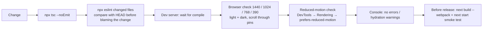

# Testing, Debugging and Development Setup

This document covers environment setup, the current check results, the recorded debugging history, the verification workflow used in development, and troubleshooting.

Related: [AI_ASSISTED_DEVELOPMENT.md §6](AI_ASSISTED_DEVELOPMENT.md#6-ai-assisted-verification) · [KNOWN_ISSUES_AND_FUTURE_WORK.md](KNOWN_ISSUES_AND_FUTURE_WORK.md)

---

## 1. Development environment and setup

### Required software
| Tool | Version | Notes |
|---|---|---|
| Node.js | **≥ 20.9** (Next 16 `engines`). Developed on **v24.22.1** | Installed through nvm-windows (`C:\nvm4w\nodejs`) |
| npm | 11.19.1 used | Lockfile v3 |
| Git | any recent | Remote `origin` → GitHub |
| Browser | Chrome / Edge | Also used headlessly for screenshot verification |

### First-time setup (Windows PowerShell)
```powershell
git clone https://github.com/Yash-Bagul01/Entersoft.git
Set-Location Entersoft
npm install
Copy-Item .env.example .env.local
# Edit .env.local and set NEXT_PUBLIC_APP_URL=http://localhost:3000 for local work
npm run dev
```

Then open http://localhost:3000.

### Environment variables (names only)
| Name | Read in | Effect |
|---|---|---|
| `NEXT_PUBLIC_APP_URL` | `src/config/routes.ts` | `metadataBase` and the production-host check. Any non-production host is served noindex. |
| `NEXT_PUBLIC_API_URL` | (not read) | Reserved in `.env.example` for a future form endpoint |
| `NODE_ENV` | `ServicesReel`, `SolutionsShowcase` | Prefetching runs only in production builds |

### Scripts (`package.json`)
| Command | Runs | Notes |
|---|---|---|
| `npm run dev` | `next dev --webpack` | Port 3000. Don't start a second instance while one is healthy. |
| `npm run build` | `next build --webpack` | Don't run it against a `.next` folder in use by a running dev server. Stop dev first, or build in a separate checkout. |
| `npm run start` | `next start` | Serves `.next` from a production build |
| `npm run lint` | `eslint` | Flat config |
| `npx tsc --noEmit` | Type check | ~1 minute on this project |

**PowerShell notes:**
- Windows PowerShell 5 has no `&&`. Use `;`, or `if ($?) { ... }`.
- Avoid long `node -e "..."` one-liners with nested quotes. Put the code in a temporary `.mjs` file instead.
- `npm warn Unknown env config "devdir"` comes from a user-level npm config. It is unrelated to this project and harmless.

### Git workflow in practice
- **Branches:** a single `main` branch, with direct commits at milestones (74 commits).
- **Commit messages:** descriptive titles such as "Services page renew", or change-request labels ("CR1", "CR 2").
- **Uncommitted work:** large edits are reviewed in the browser before committing, and AI agents are told not to commit, reset or stash.

### Configuration files
| File | Role |
|---|---|
| `next.config.ts` | Redirects, `images` (qualities, remotePatterns), `allowedDevOrigins` |
| `tsconfig.json` | Strict TS, `@/*` alias, bundler resolution |
| `eslint.config.mjs` | Next core-web-vitals and TypeScript presets, with 11 rules off |
| `postcss.config.mjs` | Tailwind 4 plugin |
| `src/styles/tokens.css`, `src/app/globals.css` | Design tokens and global CSS |
| `AGENTS.md` | AI-agent rule: read `node_modules/next/dist/docs/` before writing Next code |

## 2. Current check results

Checks run on 31 Oct 2026 against the working tree:

| Check | Result |
|---|---|
| `npx tsc --noEmit` | ✅ Exit 0, no type errors |
| `npx eslint src` | ⚠️ **14 problems: 3 errors, 11 warnings** |
| `next build --webpack` | ✅ Last recorded success 28 Oct (82 static pages). Not re-run for this documentation, to avoid disturbing the running dev server. |
| Automated tests (unit, e2e) | ❌ **None exist.** No Jest, Vitest, Playwright or Testing Library in `package.json`. |

**ESLint errors.** All three come from React Compiler rules in `eslint-config-next` 16:

| Rule | Location | Meaning |
|---|---|---|
| `react-hooks/immutability` | `src/components/platform/PlatformHubScene.tsx:182` | `startTurn` is used before it is declared |
| `react-hooks/immutability` | `src/components/sections/TrackRecord3DCylinder.tsx:97` | A variable (`index`) is reassigned after render. This error already existed at `HEAD`. |
| `react-hooks/purity` | `src/components/services/ServicesReel.tsx:435` | `performance.now()` is called during render, which makes the render impure |

**ESLint warnings:**
- 3 × `@next/next/no-page-custom-font`: Google Fonts `<link>`s in `layout.tsx` (lines 90 and 94) and in the legacy VAPT page.
- 8 × unused `eslint-disable` directives for `no-img-element`. That rule is already off in the config, so the comments do nothing.

**Rules disabled in `eslint.config.mjs`** (commit `cdeff51`, 24 Aug):
- `@typescript-eslint/no-explicit-any`, `no-unused-vars`, `no-empty-object-type`
- `react-hooks/set-state-in-effect`, `exhaustive-deps`, `refs`
- `react/jsx-no-comment-textnodes`, `no-unescaped-entities`
- `@next/next/no-html-link-for-pages`, `no-img-element`
- `prefer-const`

Turning these back on gradually, starting with `exhaustive-deps` and `no-unused-vars`, would surface real defects.

**Historical lint file:** `.tmp-eslint.txt` holds a failed run (`The unix formatter is no longer part of core ESLint`), so it contains no results.

## 3. Debugging history

Each entry records the problem, its symptoms, the root cause (only where one was established), how it was investigated, the fix, how the fix was verified, and the lesson.

### 3.1 Production build timed out under Turbopack
- **Symptoms:** `npm run build` failed. Before that, the chat had also surfaced a syntax error in `next.config.ts`.
- **Root cause (established in the "Fix build error" chat, 28 Oct):** Turbopack hit an internal timeout while processing `src/app/globals.css`.
- **Investigation:** read the build output, fixed the config syntax, and re-ran the build.
- **Fix:** `"build": "next build --webpack"` (commit `dc482ac`). The dev script had already moved to `--webpack` on 15 Oct (`7c73e23`).
- **Verification:** clean build, TypeScript passed, 82 static pages generated.
- **Lesson:** a single very large global stylesheet is a build-tool risk. Splitting `globals.css` would also make Turbopack viable again.

### 3.2 Very long dev recompiles after CSS edits
- **Symptoms:** after editing `globals.css`, the dev server stopped responding for 10–15 minutes, with Node using about 2 CPU cores.
- **Root cause:** Webpack recompiling and processing the ~3,600-line global CSS through Tailwind 4. This is an inference from repeated observation; it was not profiled.
- **Handling:** don't kill or restart the server. Poll `http://localhost:3000/` until it responds, then take screenshots.
- **Lesson:** batch CSS edits together, and prefer scoped stylesheets for new work.

### 3.3 Theme CSS ignored on the "Our practice" panel
- **Symptoms:** a dark-theme background rule had no effect.
- **Root cause:** `Differentiators.tsx` sets `backgroundColor` inline every frame (`gsap.utils.interpolate("#2a2a28","#6a6760", vis²)`), and inline styles beat normal-specificity CSS.
- **Fix:** `[data-theme="dark"] #capabilities .practice-panel { background-color: #0a1038 !important; }`
- **Verification:** headless screenshots in dark mode at 1440px.
- **Lesson:** when GSAP owns a property, override it with `!important`, or change the values the JS interpolates.

### 3.4 Measurements taken before pins settled
- **Symptoms:** screenshots and rect measurements in the light theme showed the wrong sections.
- **Root cause:** ScrollTrigger and the hand-built pins hadn't finished laying out (late images, timed refreshes).
- **Fix:** the verification scripts wait about 9 s after reload, scroll to the bottom and back, and only then measure.
- **Lesson:** automated visual checks must reproduce the scroll history that pinned layouts depend on.

### 3.5 Section seams in the landing gradient
- **Symptoms:** each section's gradient started fresh, so the boundaries between sections were visible.
- **Root cause:** each gradient was positioned relative to its own section. `position: fixed` wasn't an option because of GSAP transforms on ancestors, and `sticky` is broken by `overflow-x: hidden` on `html` and `body`.
- **Fix:** JS writes `--lg-y = −rect.top` for every instance in one rAF-batched pass (`LandingGradient.tsx`).
- **Verification:** screenshots across section boundaries in both themes.

### 3.6 Hard blue-to-black seam above the footer (dark theme)
- **Symptoms:** a sudden colour change when the footer rose over Certifications.
- **Root cause:** a blue gradient panel met the `#0b0b0b` footer. The footer timeline also scales the certifications sheet to 0.9, which exposes the section's own background around the card.
- **Fix:** set the dark-theme section background to `#0b0b0b`, and add an `.ov-sheet::after` gradient that fades to `#0b0b0b` over the lower part of the panel.
- **Verification:** three screenshots taken while the footer was mid-reveal.

### 3.7 "Ghost letters" on the Insights cards (dark theme)
- **Symptoms:** faint text appeared to show through the cards.
- **Investigation:** a zoomed crop of the screenshot.
- **Root cause:** it was the section title showing *between* the cards, not through them.
- **Fix:** made the cards fully opaque with a blue gradient anyway, to improve contrast.

### 3.8 "LandingGradient is not defined"
- **Symptoms:** a runtime error during the landing-gradient work.
- **Root cause:** the JSX was added to the sections before their `import` lines.
- **Fix:** added the imports. The error was transient while the edits were being applied.

### 3.9 Shell and tooling issues
- **`&&` in PowerShell 5:** this is a syntax error there. Use `;` instead.
- **Quoting in `node -e`:** quotes broke when passed through PowerShell. Use temporary `.mjs` scripts instead, and delete them after use.
- **Working-directory drift:** a `cd` left the shell in a subfolder, which caused `MODULE_NOT_FOUND`. Run `Set-Location` back to the repo root.
- **First screenshot run timed out:** the server was mid-compile. Poll before capturing.

### 3.10 Earlier issues (from commit messages; detail not reconstructed)
- "Main Landing issue solve", "main issue solve 2" (24 Aug)
- "Navbar issue solve" (24 Aug)
- The first Cursor prompt of the October chat: *"If I run from terminal the animations are not getting load."*

The root causes and fixes for these are **unverified** in the available records.

## 4. Verification workflow (recommended standard)



**Route smoke test (manual for now).** Visit:
- every route in [PAGES_AND_FEATURES.md §3](PAGES_AND_FEATURES.md#3-complete-route-inventory)
- every legacy URL, to confirm each redirects in one hop
- `/sitemap.xml` and `/robots.txt`

**Suggested automated additions:**
- **Playwright:** route smoke tests (status 200, single H1, canonical present), screenshot diffs per theme and viewport, and a reduced-motion run.
- **Link checker:** check every sitemap URL. It would catch the `/services/cloud-security/*` 404s.
- **Vitest:** unit tests for `routes.ts` helpers (`getServiceKeyFromSlug`, `getCanonicalUrl`, `IS_PRODUCTION_HOST`).
- **CI:** `tsc`, `eslint` and `build` on every push.

## 5. Common debugging commands

```powershell
# Is the dev server up?
(Invoke-WebRequest http://localhost:3000 -UseBasicParsing -TimeoutSec 5).StatusCode

# What is holding port 3000?
Get-NetTCPConnection -LocalPort 3000 | Select-Object OwningProcess
Get-Process -Id <pid>

# Type check / lint a single file
npx tsc --noEmit
npx eslint src/components/sections/Hero.tsx

# Find every importer of a component (dead-code check)
rg "from ['\"].*ServiceCaseHero['\"]" src

# Check a redirect
(Invoke-WebRequest http://localhost:3000/services/appsec -MaximumRedirection 0 -ErrorAction SilentlyContinue).StatusCode
```

**Animation debugging tips:**
- Add `markers: true` to a ScrollTrigger config temporarily to see its start and end lines.
- Run `ScrollTrigger.getAll()` in the console to list the live triggers.
- After layout changes, call `ScrollTrigger.refresh()`.
- For the hand-built pins, log `raw` and `p` inside `drive()`.
