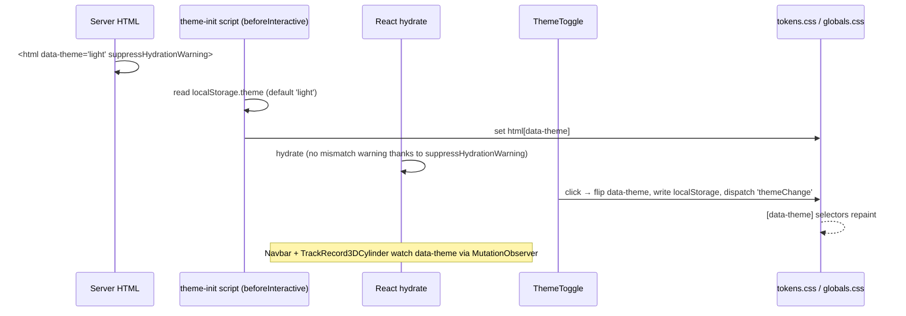

# UI/UX and Design System

This document covers the visual language, tokens, theming, typography, background systems, components, UX principles and accessibility, as they are actually implemented.

Related: [ANIMATIONS_AND_INTERACTIONS.md](ANIMATIONS_AND_INTERACTIONS.md) · [RESPONSIVE_DESIGN.md](RESPONSIVE_DESIGN.md)

---

## 1. Design direction

The site uses an **editorial, cinematic enterprise** aesthetic:

- large, tightly tracked grotesque headlines;
- generous whitespace;
- full-bleed photography and video;
- restrained colour, with near-black and alabaster plus one blue accent;
- motion used as narrative (pinned scroll stories) rather than decoration.

Many pages deliberately adapt award-site reference layouts. This is recorded in the Antigravity and Cursor plans; see [DEVELOPMENT_HISTORY.md](DEVELOPMENT_HISTORY.md). Examples:

| Reference | Where it was adapted |
|---|---|
| Exo Ape | Navigation menu and the platform case studies |
| Produx | Solutions transitions |
| Trionn | Section transitions |
| belenjones | Platform cube hub |
| Krynt / Family.co | AI-BOM |

These adaptations explain some naming in the code: `ExoApeCaseStudy`, `AiBomKryntPage`, `TrackKpisSvzPage`.

The CEO audit batches enforced a recurring **"design lock" rule**: content and claim corrections must not alter layout, typography, spacing, animation or 3D scenes.

## 2. Design tokens (`src/styles/tokens.css`)

The tokens are CSS custom properties. They are defined on `:root` and `[data-theme="light"]` (the default), and redefined under `[data-theme="dark"]`.

| Token | Light | Dark | Use |
|---|---|---|---|
| `--bg-primary` | `#f6f5f0` (alabaster) | `#060606` (jet) | Page background |
| `--bg-elevated` | `#ffffff` | `#0f0f0f` | Raised surfaces |
| `--text-primary` | `#060606` | `#f6f5f0` | Body/headings |
| `--text-secondary` | `#5e5e5a` | `#9c9c97` | Supporting copy |
| `--text-tertiary` | `#9c9c97` | `#5e5e5a` | Meta |
| `--accent` / `--accent-neon` | `#0077c8` (deep azure) | `#00A3FF` (electric blue) | Links, focus, progress bar |
| `--accent-hover` | `#005fa0` | `#33b5ff` | Hover |
| `--accent-dim` | `rgba(0,119,200,.12)` | `rgba(0,163,255,.4)` | Selection, glows |
| `--border-subtle` | `rgba(6,6,6,.08)` | `rgba(255,255,255,.08)` | Hairlines |
| `--bg-glass` / `--border-glass` | `rgba(255,255,255,.5)` / `.65` | `rgba(15,15,15,.7)` / `rgba(255,255,255,.1)` | Navbar pill, glass cards |

Layout tokens:

| Token | Value |
|---|---|
| `--max-width` | `1400px` |
| `--section-padding` | `clamp(80px,10vw,160px)` |
| `--border-radius` | `4px` |
| `--screen-*` | Mirrors of the breakpoints |

### Tailwind 4 bridge (`src/app/globals.css` `@theme`)

The `@theme` block exposes the tokens as Tailwind utilities, for example `bg-bg-primary`, `text-text-secondary` and `text-accent`. It also defines:

- **Breakpoints:** `xs 320`, `sm 375`, `md 768`, `lg 1024`, `xl 1280`, `2xl 1440`, `3xl 1920`.
- **Font utilities:** `font-sans`, `font-display`, `font-serif`, `font-mono`.
- **Animation:** `animate-cell-ripple`.

### Section surface colours (hard-coded in components)

**Light theme:**

| Section / element | Colour |
|---|---|
| Services | `#f6f5f0` |
| Capabilities | `#eae9e5` / `#e4e3df` |
| Design in Motion | `#d6d6d4` (ink `#272727`) |
| Insights | `#f3f2ee` (ink `#1b1b1c`) |

**Dark theme:**

| Section / element | Colour |
|---|---|
| Certifications (base) | `#111111` |
| Footer | `#0b0b0b` |
| Track record | `#060608` |
| Menu cells | `#1a1c1a` |

**Accents:**

| Element | Colour |
|---|---|
| Button sweep fill | `#007AFF` |
| Track-record highlight | `#1E52C8` (light) / `#96CBFF` (dark) |
| Credential tiles | CERT-In `#7CFF6B`, CREST `#FF7A2F`, ISO `#1F6B63`, GDPR `#2F7CFF` |

**Service case background colours** (set in `src/app/services/layout.tsx`):

| Service page | Colour |
|---|---|
| `/services/smart-contract-security` | `#000104` |
| `/services/ai-security-testing` | `#05061f` |

The light-theme section colours above are the components' own defaults. Since the landing-gradient work, homepage sections in both themes are mostly painted by the landing gradient (§4), with `!important` overrides in `globals.css`.

## 3. Theme system (light / dark)



1. **Before paint:** `layout.tsx` runs an inline `next/script` with `strategy="beforeInteractive"`. It sets `data-theme` from `localStorage.theme`, which prevents a flash of the wrong theme.
2. **Toggle:** `ThemeToggle.tsx` updates the attribute and localStorage, then fires `CustomEvent("themeChange")`.
3. **Consumers:**
   - **CSS:** tokens and `[data-theme="dark"] #section …` overrides.
   - **`Navbar`:** chooses its chrome variant.
   - **`TrackRecord3DCylinder`:** rebuilds its WebGL scene, because canvas textures bake the colours in.
4. **Forced themes:** some route layouts override the user's theme:

   | Route group | Forced theme |
   |---|---|
   | Service case pages | Dark |
   | Solutions | Light |
   | `/platform` hub | Light |
   | Platform modules | Dark |

   On these routes the toggle is hidden.

**Caveats:**
- Tailwind `dark:` variants follow the OS preference, not `data-theme`, because no `@custom-variant dark` is defined.
- Theme overrides in `globals.css` often target utility class names, for example `[data-theme="light"] .text-white`. This is brittle: renaming a class silently breaks the theme.

## 4. Background system and the landing gradient

The site uses four background techniques:

| Technique | Implementation | Where |
|---|---|---|
| Video backgrounds | `<video autoPlay muted loop playsInline>` | Homepage hero (S3-hosted), platform hub clips, solution heroes |
| Film grain | `GrainOverlay.tsx`, a fixed SVG `feTurbulence` noise at opacity 0.025 (0.055 with `[data-grain-heavy]`) | Global |
| Service case gradients | `solution-case.css` families `sc-obscura`, `sc-godrays`, `sc-trust`, `sc-cdo`, `sc-galactic`, `sc-prism` (26 keyframes) | After-hero band of each service page |
| **Landing gradient** | `src/components/ui/LandingGradient.tsx` plus the `.landing-gradient*` rules at the end of `globals.css` | Homepage sections 2–8 |

### Landing gradient anatomy

```text
<section style="position:relative; z-index:N">     ← host creates a stacking context
  <div class="landing-gradient landing-gradient--theme">   z-index:-1, inset:0, overflow:hidden, base gradient
    <div class="landing-gradient__flow">            height:100lvh; transform: translateY(var(--lg-y))
        ::before  repeating-linear-gradient(150deg) band, period 1200px, 64s loop
        ::after   repeating streaks, period 420px, mix-blend-mode:screen, 28s reverse loop
    </div>
    <div class="landing-gradient__veil" />          tone-specific wash for text contrast
  </div>
  …section content…
</section>
```

**Palettes:**

| Tone | Gradient stops |
|---|---|
| Dark | `#10287e → #1a2f8a 34% → #15134f 64% → #060626` |
| Light / `--theme` under light | `#e3e8fb → #eceffc → #efeaf7 → #f5f3f4` |

**Behaviour:**
- **Seamless looping:** each pseudo layer translates by exactly one period of its repeating gradient along the gradient direction, `(P·sin30°, P·cos30°) = (0.5P, 0.866P)`. The last frame is therefore identical to the first.
- **Continuity across sections:** every instance's flow layer is shifted by `--lg-y = -rect.top`, so all layers paint the same viewport-anchored pattern. Section boundaries then look like one continuous background (see the [algorithms doc](ALGORITHMS_AND_PROGRAMMING_CONCEPTS.md#7-viewport-anchoring-for-a-continuous-background)).
- **Reduced motion:** all three animations stop.

**Per-section dark-theme decisions** (from the Oct 2026 iterations):
- **"Our practice" panel** (FIND / VALIDATE / REMEDIATE / VERIFY) is solid midnight navy `#0a1038 !important`. `!important` is required because GSAP writes its `backgroundColor` inline.
- **Certifications** sits on `#0b0b0b`. A `.ov-sheet::after` gradient fades the blue into footer black, which avoids a hard seam where the footer rises.
- **Stripe-wipe bars:**

  | Theme | Bar colour |
  |---|---|
  | Dark | `#0c1a5c` |
  | Light | `#eceffc` |

- **Insights cards** in dark use an opaque blue gradient `#2a3e9c → #181c5c → #0e0e38` with a light border.
- **Work in Motion** text and arcs switch to light ink in dark (`#f6f5f0`).

## 5. Typography

| Family | Loaded via | Role |
|---|---|---|
| **Familjen Grotesk** | `next/font/google`, instantiated separately in ~10 components (ServicesShowcase, Differentiators, Testimonials, DesignInMotion, CertificationsMarquee, TrackRecord, Navbar, Footer, ExoMenuOverlay, DiscussProjectModal) | De-facto display and UI face of the homepage and chrome |
| Inter Tight (300–700) | `next/font` → `--font-inter-tight` | Headings on several pages |
| Inter | `next/font` → `--font-inter` | Body (`--font-body`) |
| IBM Plex Mono (400–600) | `next/font` → `--font-ibm-plex-mono` (and again via a `<link>`) | Labels, eyebrows, buttons (`Button` is mono, 11px, uppercase) |
| Instrument Serif | Google Fonts `<link>` | "ENTERSOFT" serif watermark in TrackRecord |
| Fraunces, Schibsted Grotesk, Bricolage Grotesque, Syne, Plus Jakarta Sans, Cormorant Garamond | Google Fonts `<link>` in `<head>` | Page-scoped overrides on platform and solution pages |

**Type scale.** There is no fixed scale. Sizes are fluid with `clamp()`, for example `text-[clamp(2.75rem,5.94vw,5.344rem)]` for the "Enterprise Services" title. Headlines use tight leading (0.9–0.95) and negative tracking (`-0.06em`). Eyebrows are mono 11–12px, uppercase, tracked `0.14em`.

**Known defects:**
- `--font-heading` references `--font-geist-sans`, and `--font-mono` references `--font-jetbrains-mono`. Neither variable is defined anywhere, so `h1–h6 { font-family: var(--font-heading) }`, `font-display` and `font-mono` fall back to the inherited font.
- The `@theme` entries `--font-mono: var(--font-mono)` and `--font-serif: var(--font-serif, …)` reference themselves.
- Eight Google Fonts stylesheets are render-blocking `<link>`s, not `next/font`.

## 6. Components

### 6.1 Primitives (`src/components/ui`)

| Component | API | Behaviour |
|---|---|---|
| `Button` | `variant: primary\|secondary\|ghost`, `size: sm\|md\|lg`, `asLink`, `href`, `target`, `rel` | Mono uppercase button. `primary`/`secondary` use the `.btn-sweep` fill animation (the `#007AFF` sweep). `asLink` renders a raw `<a>`. The forwarded ref only reaches `<button>`, so the magnetic effect does not attach to link buttons. |
| `MagneticButton` | `children`, `strength=0.35`, `radius=90` | Clones its child with a `useMagnetic` ref |
| `SectionLabel` | `color: accent\|secondary\|tertiary` | Mono eyebrow |
| `AnimatedDivider` | — | 1px rule that scales in on view |
| `LandingGradient` | `tone: light\|dark\|theme` | §4 |
| `StripeWipeBars` | — | Six `.ov-stripe` spans for `useStripeWipe` |
| `ThemeToggle` | — | Sun/moon `<button>` with `aria-label` |

### 6.2 Chrome and patterns
- **Navbar:**
  - Transparent over the hero, then a glass pill (`--bg-glass` plus backdrop blur).
  - Mega menus with grouped columns and a CTA card.
- **Full-screen menu:** `ExoMenuOverlay`, with a grid-cell wipe, primary and secondary items, and flyouts.
- **Footer:** a sheet that rises over the last section, a 6-column directory, the line-art wordmark canvas, and links with curve underlines.
- **Cards:**

  | Card | Where | Form |
  |---|---|---|
  | Outcome cards | Capabilities | Photographic |
  | Service cards | Design in Motion | 28px radius, CSS 3D flip to reveal the back copy |
  | Glass cylinder cards | Track record | 3D |
  | Brief cards | Insights | Portrait |
  | Spiral and reel cards | Solutions hub, Services hub | — |

- **Accordions:** used in the ServiceCasePage FAQ, the ExoApe FAQ and the editorial `faq` block.
- **Tabs:** with `layoutId` indicators in some platform sections.
- **Modal:** `DiscussProjectModal`, a bottom sheet with a focus trap.
- **Interactive diagrams:** `AttackPathVisualizer` (ASPM) and the WebGL cylinder.

## 7. Accessibility

| Practice | Status | Evidence |
|---|---|---|
| Reduced motion | Implemented | `useReducedMotion` (~100 files) gates GSAP, Lenis, video and WebGL. A global CSS rule sets every animation and transition to `0.01ms`. 26 media queries across 13 files. |
| Focus visibility | Implemented | `:focus-visible { outline: 2px solid var(--accent) !important }` |
| Dialog semantics | Implemented (modal) / partial (menu) | `DiscussProjectModal` has `role=dialog`, `aria-modal`, `aria-labelledby`, a Tab trap, Escape and focus restore. `ExoMenuOverlay` has dialog roles and Escape, but no focus trap and no initial focus. |
| Icon buttons labelled | Implemented | ~49 `aria-label`s (arrows, close, prev/next, scroll cue) |
| Decorative layers hidden | Implemented | ~106 `aria-hidden`, including the landing gradient and transition overlays |
| Image alt text | Mostly implemented | Content images use names (service `displayName`, credential labels). Decorative images use `alt=""`. |
| Keyboard mega menus | **Missing** | Desktop menus open on hover only and have no `aria-expanded` |
| Skip link / `main` landmark id | **Missing** | — |
| Heading outline | Issue | Two `<h1>`s on the homepage |
| Input zoom prevention | Implemented | Inputs are forced to 16px (iOS) |
| Scrollbar | Hidden globally | Replaced by a 2px accent progress bar. This removes a visual scroll affordance. |

## 8. UX principles applied

1. **Plain-language findability, branded memory.**
   - Titles and H1s use search terms, for example "Penetration Testing Services | CREST-Accredited".
   - Branded descriptors ("Adversarial Validation") appear as eyebrows. This follows the SEO master.
2. **One idea per scroll beat.** Pinned stories hold the viewport while one message resolves:
   - the hero statement swap;
   - the cylinder phases;
   - the practice panel;
   - the stacked briefs.
3. **Progressive disclosure.**
   - Hovering a service name reveals its summary and image.
   - Card flips reveal detail.
   - FAQ accordions hold the secondary material.
4. **Every scroll story ends in an action.** The hero has the briefing and EnProbe CTAs, Testimonials has "Become a Client", Certifications has "View credentials", and the footer has "Discuss your project" and "Book a call".
5. **Touch parity.** Fine-pointer hover interactions become tap-to-select on touch:
   - In `ServicesShowcase`, the first tap selects and the second navigates.
   - Lenis smoothing is off on compact screens.
   - The custom cursor is disabled.
6. **Continuity.**
   - Page transitions (column wipe, image expand) keep the user oriented between hubs and detail pages.
   - The landing gradient removes visual seams between homepage sections.
7. **Feedback states.**
   - Forms show submitting and success states.
   - The active service is marked with `aria-current`.
   - The navbar changes state on scroll.

Gaps against these principles are listed in [KNOWN_ISSUES_AND_FUTURE_WORK.md](KNOWN_ISSUES_AND_FUTURE_WORK.md): keyboard access to the mega menus, the skip link, the simulated form submit, and the `/booking` placeholder.
